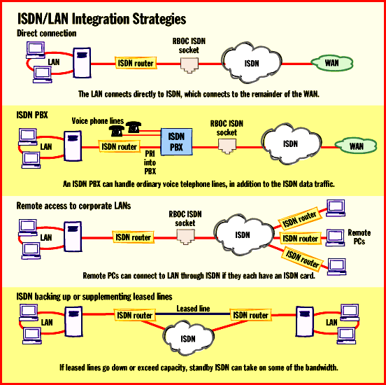
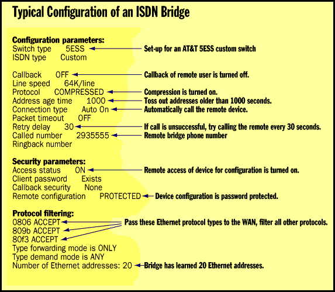
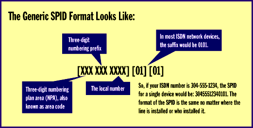

# From LAN to WAN with ISDN

*Features*

JISDN/LAN integration is sometimes complex, but the rewards are worth it.

Jeffrey N. Fritz

Evangelists often tout the glamorous applications such as videoconferencing, real-time audio, and collaborative computing when they're preaching about the virtues of ISDN. But for many corporations, ISDN can be a cost-effective solution for linking LANs to remote sites and telecommuters, to enterprise networks, to business partners and clients, and to the Internet.

ISDN promises WAN connections that are up to 10 times faster than a 28.8-Kbps modem, call-setup times measured in milliseconds, costs that accrue only when using the digital pipe, flexible configurations, and near error-free transmissions. All this bodes well for integrating ISDN into LAN and WAN connections.

If you can get it at your location (and you probably can), ISDN can provide significantly enhanced remote LAN access. ISDN network equipment, once too pricey for the average user, has fallen into the affordable range. And while there has been some ambivalence from the telephone companies in setting ISDN rates, the general cost trend has been downward. ISDN/LAN integration benefits corporations, telecommuters, small office/home office workers, and Internet service providers. But all is not rosy when it comes to integrating ISDN into the LAN infrastructure.

Optimizing for ISDN

ISDN lines come in two flavors. The Basic Rate Interface (BRI) supports two 64-Kbps digital channels (called B channels) and one 16-bit D channel for carrying signaling and control information. The primary rate interface (PRI) uses a single D channel and 23 B channels (or 30 B channels in Europe). ISDN has some notable advantages, especially when compared to analog phone lines, that make it ideal for the networked computing environment: It's digital, it supports both voice and data on a single line, and call-setup times are fast enough to make connections almost seamless.

Although ISDN can optimize WAN connections, its transmission speed of 64-Kbps is still meager when compared to the native bandwidth of most corporate LANs. Therefore, it's vital to maximize the efficiency of the slower WAN connections. Most network devices come equipped with a variety of tools to overcome the lower bandwidth capacity of ISDN WAN links. Optimization strategies include combining ISDN B channels for additional bandwidth, filtering out unnecessary traffic from the WAN connection, and compressing data to achieve effective throughputs much greater than 128 Kbps. All these measures make the ISDN WAN perform more efficiently.

ISDN connections can be more economical than leased lines when WAN connectivity is intermittent, thanks to features such as networking on demand and bandwidth on demand (BOD). (For a comparison of current and future WAN technologies, see the chart

%"Linking LANs: ISDN and Alternatives"

Unlike the case with a leased line, ISDN connection charges are based on usage, much like a standard phone call. When the ISDN line is not in use, you don't pay for it. To save money, many ISDN network devices are programmed to drop the WAN connection after a period of inactivity. Networking on demand keeps the call disconnected when there is no traffic for the network.

Much as networking on demand lets you pay for the connection only when you need it, BOD lets you pay for bandwidth only as you need it. Not all network applications need the same bandwidth, and not all applications need the same bandwidth all the time. BOD can accommodate changes in WAN bandwidth requirements by aggregating multiple B channels into one faster virtual B channel. Depending on the device, bandwidth is usually scaled in 64-Kbps increments, called N by 64, all the way from 64 Kbps to T1 rates (1.544 Mbps). When traffic demands fall off, the additional channels can be dropped. If traffic picks up again, more channels can be allocated according to need. This channel flexibility makes WAN connections more cost-efficient than a dedicated line that incurs the cost for bandwidth whether it is used or not.

ISDN network devices that offer BOD generally do so by using the Multilink Point-to-Point Protocol (MP). MP can allocate and deallocate up to six B channels at once on-the-fly. MP negotiates channels rapidly, making it ideal for the bursty nature of network applications.

Compression Varies

Compression increases the apparent bandwidth of a WAN connection by reducing the size of the data files traversing the pipe. However, unless network devices support the same compression suites, the connection will come up without compression. That can slow down the WAN link considerably.

Compression figures are partially determined by file type. Ordinary text (ASCII) files compress well, binary files not so well, and precompressed files poorly. If a vendor measures compression strictly with text files, it will get a very high compression ratio. Another vendor, using the same compression algorithm with a mix of text, precompressed, and binary files, will report a much lower and probably more realistic number. Networks generally have a combination of all three file types traveling across the wires. So when you hear throughput numbers based on compression schemes, be wary. Try to find out the data mix used to devise the throughput numbers.

Most ISDN network devices, working in the real world with a decent mix of file types, can deliver 3:1 compression. Typically, the measured bandwidth for a connection with two B channels is 95 to 105 Kbps. Therefore, with 3:1 compression, the real WAN throughput would generally be about 315 Kbps. While not 10 Mbps, this is respectable throughput -- more than 10 times greater than that offered by a 28.8-Kbps modem.

Hardware and Software

If you have ever configured a bridge or router, you should have no difficulty handling most ISDN network devices. However, there are issues to keep in mind when integrating ISDN with LANs (see the figure

!"ISDN/LAN Integration Strategies"

above). Configuring an

ISDN bridge

, for example, includes setting parameters for switch type, ISDN type, callback (on or off), compression, protocol filters, and security for remote access.

Hardware components in the ISDN/LAN equation include terminal adapters (TAs), ISDN bridges and routers, remote-access servers, and ISDN PC Cards. The TA connects your PC into the ISDN line. These devices are offered in both internal and external configurations, but keep in mind that the serial port's 115.2-Kbps data rate will become a bottleneck on an aggregated ISDN connection (128-Kbps or better). If you have remote PCs that need to hook into your LAN via ISDN, they will each need a terminal adapter installed. Major manufacturers such as Motorola, 3Com, and US Robotics now offer terminal adapters for an average cost of about $500.

Most ISDN/LAN solutions use routers to direct traffic across the LAN/WAN link. Simple bridges do not always support the type of filtering required for network-on-demand configurations. ISDN routers usually support Ethernet connections to the LAN and a BRI or PRI port for the ISDN link. BRI routers cost $1000 to $1500.

If you're using ISDN to support telecommuters or other mobile workers, you'll need to consider remote-access solutions. Remote-access products from vendors such as Shiva, Microcom, and Gandalf now support ISDN. Remote- access servers with up to eight BRI ports range from $7000 to $10,000. Many models also support standard analog connections, so users well-served by your current analog solution won't have to upgrade right away. Of course, most telecommuters and mobile users carry portable computers, so they'll need an external TA or, better yet, an ISDN PC Card. Current PC Cards such as the IBM WaveRunner are somewhat bulky solutions because the required network terminator is not built in, but that should change soon as vendors ship cards with integrated network terminators.

Client Concerns

Whenever you add clients to a network, you've got to handle the assignment of network addresses, particularly for TCP/IP. With some protocols, such as IPX/SPX or AppleTalk, assigning addresses is semiautomatic. But for TCP/IP, you've got to do it manually with static addresses or dynamically through protocols such as Dynamic Host Configuration Protocol (DHCP) or Bootstrap Protocol (BootP). The point is that remote IP clients must be given an appropriate network address and subnet mask whenever they are connected to the enterprise IP network or the Internet.

Additionally, whenever a client, remote or not, comes on the network, the network topology changes. This can be particularly tricky with network-on-demand connections that are dropped during inactivity. This capability can cause problems for hosts and network protocols that may be looking for the disconnected remote client. On a client/server network, acknowledgment packets are often sent between nodes, even when the nodes are not sending live data. The packets can trigger a connection when one is not needed, which incurs additional costs. Different methods of spoofing fool the network by acknowledging the LAN packets locally, as if the WAN connection were still active. Spoofing can save significant costs by preventing unnecessary connections.

It's important to minimize superfluous traffic on the WAN. Typically this is done with address and protocol filtering. You can block unwanted protocols from the WAN link with intelligent filtering. You can also block WAN traffic to selected addresses. This is a key requirement, particularly when chatty protocols that may be on the enterprise network do not need to cross the ISDN WAN.

Hard to Order

An unfortunate problem that has plagued ISDN implementation since its inception is its burdensome ordering process. Although strides have been made in simplifying ordering and configuration of ISDN lines and equipment, the technology itself is complex, and some of the configuration details reflect this complexity.

One of the most confusing parts in integrating ISDN with LANs is in configuring the ISDN network device. Of all the parameters that must be entered, by far the most mystifying is the service profile identifier, or SPID. The

SPID is used

to identify the ISDN device to the ISDN network, much like an Ethernet address identifies a computer's network interface card. Without the SPID, which looks like a telephone number with a bunch of extra digits thrown in, the ISDN device simply will not work on most lines.

SPIDs are tricky because they vary from ISDN switch to ISDN switch. For example, some switches require a single SPID for both B channels in a BRI configuration. Other switches may want different SPID numbers assigned to each channel. The SPID itself can vary in format depending on what the switch expects. To make matters even more confusing, some switches do not require a SPID at all.

There is hope that SPIDs will soon be made a little easier. The North American ISDN Users' Forum, along with a number of switch vendors including Lucent Technologies, Nortel, Siemens, and Ericsson, has proposed the Generic SPID Specification. Basically, the Generic SPID replaces the horrendously wide variations in format with one common SPID format for all new ISDN installations. This format is similar to an ordinary phone number, with a three-digit area code (the numbering plan area, or NPA) followed by a three-digit prefix and four-digit local number, but with a four-digit suffix (usually 0101) tacked on.

Getting Up to ISDN Speed

Inside your local telephone building sit the multimillion-dollar digital switches that are owned by the phone company. Until now, you probably could not care less about them. But with ISDN you are expected to know what switch is in your serving office, which software version it is running, and what form of ISDN (Custom or National) it is offering. You need this information to properly configure your ISDN network devices.

To configure a typical ISDN router, for example, you need to know how standard items like filtering, compression, call-back, and security are handled. On top of that, the device configuration might also call for switch parameters such as line speed, switch type, and ISDN type. Without this information, which you must glean from your local phone company, the device probably won't work.

And don't assume that your network equipment is compatible with the local ISDN switch unless your vendor specifically says it is. While much of today's ISDN network equipment is designed to work with a variety of ISDN switches, there are still a few devices that are designed to operate only with a specific switch. These devices, when operated on an incompatible switch, either work poorly or not at all.

The good news for users is that National ISDN, a highly interoperable form of ISDN, is now becoming widely available. Currently, there are three National ISDN versions: NI-1, NI-2, and NI-95. Most NI-1 devices will work with virtually any NI-equipped switch, usually without a lot of difficulty.

No matter what version you choose, ordering and configuring ISDN is still complex. Fortunately, once you get beyond the up-front hassles, you'll appreciate the payoff. ISDN brings powerful features to the LAN/WAN environment:

High-quality digital lines reduce errors during data transmission.

Bandwidth on demand and network on demand save significant costs over a leased line for intermittent LAN-to-LAN or LAN-to-WAN connectivity.

ISDN is very flexible, especially when compared to a leased line, allowing you to establish alternate connections quickly and transparently with other ISDN-enabled sites.

Dial-up and call connection are fast and transparent.

The bottom line is that ISDN/LAN integration extends your LAN out to the world in an efficient, cost-effective way. Plus, remote users will love their enhanced connections.

$Linking LANs: ISDN and Alternatives

Billing Structure Strengths Weaknesses

Current Technologies

Leased Lines Fixed rental by speed Cheap for constant, Too costly for

M and distance high-volume access occasional use

JX.25 By speed, call dura- Good for interactive Data volume

P tion, data volume applications charge costly for

L file transfer

Analog Dial-up Same as telephone Okay for short, Low speed,iffy

Services calls nonrecurring quality, long

O communications call setup; poor

G security

MISDN By call duration, Cheap file transfer, Can be hard to

O time of day, distance, cheaper than leased order and set up

O per call line for occasional not available in

I use, easy to add some areas

7 more sites and

6 bandwidth

Future Technologies

Broadcast Monthly charge for Very low cost after Inbound data only

; Satellite unlimited usage initial investment

< (excellent for Web)

Cable Modems Purchase cable modem, High bandwidth, low Regulatory red

P setup and monthly investment, cable tape, devices not

M rates probably already yet widespread

2 installed

Asymmetrical Still in trial mode High downstream Modest to low

Digital (no pricing yet) bandwidth, works upstream band-

Subscriber Line over regular phone width, not ready

M lines for prime time

## ISDN/LAN Integration Strategies

You can implement ISDN in a variety of ways to accommodate your communications equipment and applications.

(Typical Configuration of an ISDN Bridge

Network administrators need to use parameters specific to ISDN services in order to configure bridges properly.

$The Generic SPID Format Looks Like:

The service profile identifier, or SPID, looks like a phone number, but its job is to identify the ISDN device for the ISDN network.

mailto:"jfritz@wvu.edu"

Jeffrey Fritz is responsible for the operations of West Virginia University's data networks. He is chair emeritus of the North American ISDN Users' Forum Enterprise Network Data Interconnectivity Family. Fritz is author of Remote LAN Access: A Guide for Networkers and the Rest of Us and Sensible ISDN Data Applications. You can reach him at

jfritz@wvu.edu

## Images

