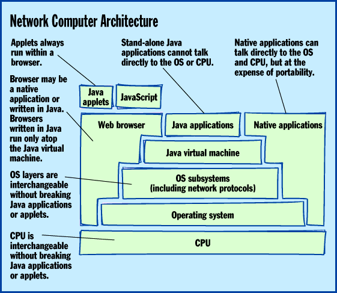
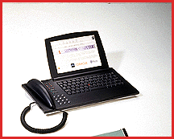

# Inside the NC

*Features*

Are network ocmputers just stripped-down terminals? No way. The official NC platform definition covers everything from a set-top box to a Cray.

Peter Wayner

Be suspicious when someone denounces network computers as being just dumb terminals: Either they don't know what they're talking about, or they're hoping you don't.

A network computer may indeed be a dumb terminal. It may even be a dumb terminal that runs Windows and applications faster than your PC does. Or it could be a conventional PC or Macintosh. It could be an under-$500 TV set-top box or a million-dollar Cray supercomputer. It could be a desktop system tethered to a LAN or even a mobile notebook computer with a modem. A network computer can be any of these things because it's a unique platform that doesn't specify the type of hardware, CPU, or OS it sits on. Instead, it defines an open client model centered around familiar Internet standards and Java.

If this description of a network computer conflicts with what you've heard elsewhere, keep in mind that some people (and companies) who apparently feel threatened by this computing model appear to be spreading disinformation. Other sources are merely uninformed. Most of all, many companies today toss around the term "network computer" rather loosely, along with other terms such as Internet appliance, Web PC, browser box, and net-top box (see "Inside the Web PC," March BYTE cover story).

"Network computer" can be used as a generic term like "personal computer" or "PC." It can also refer to a specific platform standard, just as "PC" often refers to the standard originated by IBM with its Personal Computer in 1981. This article examines the specific network computer platform defined by a loose alliance of companies led by Oracle, Sun Microsystems, IBM, Apple, and Netscape. In fact, Oracle has trademarked the names "Network Computer" and "NC" and has spun off a new company called Network Computer Inc. This group's official NC standard encompasses a wide variety of computing devices for business, education, and home markets.

Defining the Standard

Oracle's vision has two parts. First is the NC Reference Profile. Only computers that offer all the features in the profile can wear the designation "NC." A test suite of Java applets and documents will allow any manufacturer to verify compliance and earn the designation. Numerous hardware and software companies are supporting this profile. (See the sidebar "What It Takes to Make a Network Computer".)

In addition, Oracle's Network Computer subsidiary is developing and marketing a software package called the Oracle NC System Software Suite. It includes a microkernel OS known as NCOS, Sun's Java application environment, a Java-enabled Web browser, Macromedia's Director player, Oracle's Media Objects player, and additional software. A company that wants to sell an NC with a minimum of fuss could simply license this suite from Oracle and ship it along with the NC-compliant hardware (see the sidebar "Oracle NC System Software Suite").

The NC Reference Profile is not a radical document. It's just a list of what a system has to offer to make the cut. The Mac I'm using to write this article satisfies all the requirements because I've installed Eudora, Netscape Navigator, and Sun's Java Developer's Kit.

The NC basic hardware requirements are simple: a 640- by 480-pixel screen, a pointing device, some provision for text input, and audio output. A hard disk, floppy drive, or other form of persistent local storage is optional. There must be a network connection that can carry IP packets, but the channel is flexible: You can use an ordinary analog modem, a cable modem, a wireless modem, ISDN, or a LAN.

The software requirements are equally conservative. NCs must communicate over a network using standard IP protocols: TCP, User Datagram Protocol (UDP), Dynamic Host Configuration Protocol (DHCP), Bootstrap Protocol (Bootp), and Simple Network Management Protocol (SNMP). If users store their data remotely, Sun's Network File System (NFS) will be the standard method for mounting remote drives. Optionally, NCs can support remote connections to other systems via FTP or Telnet, and they can establish secure connections via Secure Sockets Layer (SSL).

Some of these protocols are probably less familiar than others. UDP allows NFS to set up end-to-end application-specific communications. Bootp enables an NC to boot over a network. DHCP allows an NC to automatically acquire an IP address and send configuration data over the network when it boots. SNMP ensures that NCs will act like well-behaved clients on managed networks.

The key requirement in the profile is the ability to read and interpret Hypertext Markup Language (HTML) documents through the Hypertext Transfer Protocol (HTTP). In other words, the NC must run a Web browser. For now, the NC Reference Profile doesn't specify which version of HTML or which tags are required. To exchange e-mail, NCs will use a collection of well-understood mail protocols that dominate the Internet: Simple Mail Transfer Protocol (SMTP), Internet Message Access Protocol version 4 (IMAP4), and Post Office Protocol version 3 (POP3).

In addition, NCs must recognize the most common multimedia formats encountered on the Internet: JPEG and GIF graphics and WAV and AU audio files. Still to come are recommendations for sending output to printers.

Must Have Java

Perhaps the most fundamental requirement is that NCs must support the Java application environment, which includes the Java virtual machine (VM), the Java run-time interpreter, and the standard Java class libraries. There's nothing to prevent an NC from also running software written for Windows, MS-DOS, the Mac OS, Unix, OS/2, or any other OS. But at minimum, it must run Java.

In fact, there is no description of the OS layer at all in the NC Reference Profile. Theoretically, you could use CP/M or MVS if they supported the Java VM. In practice, however, there are some problems. For example, Java programs can be multithreaded, even though some OSes that support the Java VM are single-threaded. Currently, the behavior of multithreaded code varies from system to system because some OSes, like Windows 3.1, don't do a good job of supporting multiple threads. Others, like the Mac OS, do a reasonable job but don't offer preemptive switching with various priority levels. The best OS for an NC is one that offers full-fledged preemptive multithreading.

Above all, the OS must maintain a TCP/IP stack so the NC can communicate with the outside world. Other OS functions take a back seat -- even file management and the user interface. In fact, there's no special GUI for an NC; in the absence of anything else, the Web browser can act as the GUI. If the user requests a file directory of a local or remote drive, the OS can format the directory listing into HTML and display it in the browser. (This isn't unique to NCs; some browsers on PCs already do this for FTP sessions, and Microsoft is adding optional browser views to Windows.)

Because the NC platform is neutral below the Java VM, an NC vendor can change the OS, the CPU, or just about anything else without affecting the user -- if the applications are written in Java. (See the figure

"Network Computer Architecture"

.) Since Java is the only software guaranteed to run on all NCs, the success of the NC platform depends in large part on the success of Java.

Most Macs and PCs can hit the NC reference target with software you can get for free or little cost. Eudora Lite can handle the e-mail chores, and a free Web browser such as Microsoft's Internet Explorer can display HTML. Sun distributes free versions of its Java Development Kit that can execute Java applets. Some of these packages aren't full-featured, but you can purchase commercial versions at modest cost. In fact, the latest version of Netscape Navigator will handle both the HTML and e-mail requirements.

NC-Specific Hardware

Cs can be based on a wide variety of different processors and OSes, including some configurations optimized for low retail price and easy administration. For example, Oracle has an NC

reference design

whose parts cost less than $300. (Oracle says it has no intention of manufacturing NCs; the reference design is for other vendors to use.) In corporate environments, the lower administration costs will be more important in the long run than the initial purchase price.

Most NCs will probably be desktop machines, but there's no reason why a mobile computer can't support the NC standard if it has occasional access to some sort of network. The NC standard does not require constant network connections. Mobile NCs will probably have some form of local storage to hold information between network sessions.

Some NCs will be set-top boxes that use a TV as the display device and connect to the Internet via a phone or cable modem. Just about all they need is a relatively fast CPU, a video controller, a network interface chip, and 4 to 8 MB of RAM. The latest home videogame machines from Nintendo, Sega, and Sony are more than powerful enough and cost less than $300. The Nintendo 64 and Sony PlayStation have speedy CPUs based on the Mips R4000 and video capabilities that would put a $2000 PC to shame.

Acorn, a major Oracle partner in the development of NCOS and the NC reference design, plans to introduce a low-cost NC this fall through a U.K. subsidiary, NChannel International. The NC will make its debut in the U.K. at an anticipated price of about 400 pounds UK (approximately $620). Acorn hopes to introduce a U.S. version a few months later that will sell for about $400. Another company, NetChannel International, is planning to launch a consumer-oriented Internet service for NC users that would put a friendlier face on the Internet and the Web.

One of the most controversial features of the NC is the lack of local storage. This is completely optional, but there are good reasons to leave out the hard drive. The first is cost. Although prices have plunged, it's still difficult to buy drive mechanisms for less than $75, and this can add at least $150 to the retail price. More important, local hard drives invite unskilled users to install untested software. This leads to the administration problems that plague PCs.

Some NCs will have local storage for caching purposes only. The OS and frequently used applications may reside on a local hard disk that's as transparent to users as a CPU cache. For longer-term storage of user files, these devices will rely on network servers.

For instance, Corel could sell its drawing software as Java applets that store their data on the same HTTP servers that offer the applets on the Web. If you create a drawing, you don't need to store it locally; you could store it on the Corel server. This frees users from the responsibility of creating backups. Of course, the downside is that moving large documents across the network consumes bandwidth. It's not the ideal client/server model if the files are large and the network connection is slow.

If the files are relatively small or if the connection is fast (for example, an Ethernet LAN or a broadband modem), a stripped-down NC coupled with a smart server could provide many of the functions of a traditional PC at a fraction of the cost. It's not really a new client/server model, but it does expand the definition of a client.

What's Missing?

The biggest problems in the NC concept are lack of compatibility with existing software and the slow speed at which the machines will run certain kinds of software. Backward compatibility isn't required by the reference specification, which leaves a Java-only NC at the mercy of Java. Simple solution: If the software you need hasn't been ported to Java, then don't buy a Java-only NC. Note that this doesn't prevent you from buying a so-called "thin client." You can still get relatively inexpensive and easily administered terminals that run Windows applications on a Windows NT server with Citrix multiuser software. Some of those terminals also meet the NC specification, so they're Java-ready.

Slowly executing software is another Java weakness. Java bytecode is interpreted, so it typically runs only 3 to 10 percent as fast as native code compiled in C. Just-in-time (JIT) compilers may soon boost the performance of Java programs to about 50 percent the speed of native code. Still, there's a performance gap that may never be closed.

For some kinds of applications (word processing, Web browsing, database access, casual spreadsheet work), the difference may not be noticeable. For others (high-end image editing, graphics design, serious number-crunching, software development, games) the difference could be dramatic.

One solution is to take some well-designed APIs, such as Apple's QuickDraw 3D, and meld them into the Java class hierarchy. Java has a provision for classes compiled in native code, and this could provide significantly better performance. Of course, the native classes would have to be ported to different machines, but the cost might be worth the benefits.

Another solution is to optimize CPUs for Java. Sun is already working on Java-specific chips, and another chip vendor is planning to include Java optimizations in the next revision of its RISC instruction set. These chips are still in the testing stages, however (see the State of the Art article "Sun Gambles on Java Chips").

In the meantime, the NC standard will evolve. The NC Reference Profile will undergo revisions as the partners become convinced that new technologies are popular enough and good enough to warrant making them part of the NC foundation, says Lu Kabir, vice president of worldwide sales for Network Computer Inc. In the future, video streaming and MPEG-2 decoding could allow an NC set-top box to replace a cable TV box. The NC standard will embrace Internet telephony in coming months, Kabir promises.

One of the most interesting (but currently optional) features of the NC specification is the ability to read ISO 7816-standard smartcards. These credit card-size devices contain a chip that can store personal information, such as bank balances or health records. They can also act as identification tokens because they can hold a public-key certificate. You could use an NC with a smartcard to download electronic cash or other types of secure information over the Internet.

Earning Respect

Moving forward from a collection of trademarks and buzzwords to a computing platform that earns respect in the marketplace is a hazardous endeavor that has defeated many seemingly good ideas. The NC spec makes a good start by building upon standards that already are commonplace. The ability to retrofit a PC as a makeshift NC provides an easy migration path for those who don't want to gamble on a very different kind of device.

But the NC concept also builds upon trends that are emerging with the development of the Internet. For some users, Web browsing and e-mail are major applications in their own right. Corporate intranets are beginning to challenge PC-centric networks and applications. Many databases are now accessible to Web browsers. Platform-independent productivity programs, such as word processors, are already under development.

The NC Reference Profile wisely avoids specifying an OS, CPU, and GUI. With technology in flux, setting a rigid standard is like trying to hit a moving target. The NC profile recognizes this and leaves them out of the picture.

Perhaps the biggest question is whether any force smaller than Microsoft can establish a new industry standard. Publicly, Microsoft still ridicules the concept of network computers. At the same time, Microsoft says it is committed to making all the software in the Windows realm capable of interacting with the Internet. Wintel PCs will soon meet the NC standard even though, for political reasons, they may never bear the trademarked name.

## Where To Find

NC Reference Profile

http://192.86.154.91/nc_ref_profile.html

Internet:

(http://192.86.154.91/nc_ref_profile.html

NC System Software Suite

http://www.oracle.com/products/nc

Internet:

!http://www.oracle.com/products/nc

Acorn

Cambridge, England

http://www.acorn.co.uk/anc

Internet:

http://www.acorn.co.uk/anc

Apple Computer

Cupertino, CA

http://www.pippin.apple.com

Internet:

http://www.pippin.apple.com

## IBM

Armonk, NY

http://www.internet.ibm.com

Internet:

http://www.internet.ibm.com

Channel International

Cambridge, England

http://www.nchannel.com

Internet:

http://www.nchannel.com

NetChannel

Palo Alto, CA

http://www.netchannel1.com/index.html

Internet:

%http://www.netchannel1.com/index.html

## Netscape

Mountain View, CA

http://home.netscape.com

Internet:

http://home.netscape.com

Oracle

Redwood Shores, CA

http://www.oracle.com

Internet:

http://www.oracle.com

## Sun Microsystems

Mountain View, CA

http://www.sun.com

Internet:

http://www.sun.com

## Network Computer Architecture

The Network Computer Reference Profile is based on an architecture not chained to specific hardware or operating system.

## For Reference Only

One of Oracle's four reference designs integrates a phone with an NC.

mailto:"pcw@access.digex.net"

http://www.access.digex.net/~pcw/

|BYTE consulting editor Peter Wayner frequently writes about the Web and other Internet-related topics. You can reach him at

pcw@access.digex.net

or view his home page at

!http://www.access.digex.net/~pcw/

pcwpage.html.

## Images

