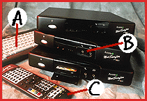

# What It Takes to make a Network Computer

*Features*

NC Reference Profile Requirements

Java application environment (which includes the Java virtual machine, Java run-time interpreter, and standard Java class libraries)

Text input capability

Audio output

Pointing device

Minimum screen resolution: 640 by 480 pixels

TCP/IP networking

Simple Mail Transfer Protocol (SMTP), Internet Message Access Protocol v.4 (IMAP4), and Post Office Protocol v. 3 (POP3) e-mail protocols

SNMP for network manageability

Ability to use the following file formats: HTML, JPEG, GIF, WAV, AU

Oracle NC System Software Suite

All network computers built to Oracle's NC reference specifications will run NCOS and the NC System Software Suite without porting. The next version of the software suite will include a portable OS capable of running on multiple hardware platforms, Oracle says.

NCOS is based largely on a multitasking OS from Acorn. Key features include antialiasing and dithering algorithms that make it possible to display high-quality text and graphics on lower-grade monitors and TVs. NCs can work with regular computer monitors, of course, but low-end devices for consumers may rely on a TV as the display device. The software must be compatible with GIF, GIF89a, JPEG, QuickTime, Indeo, AVI, WAV, AU, and Shockwave files.

The NC System Software Suite includes the following components:

NCOS

Web browser

Macromedia Director player

Oracle Media Objects player

Oracle Interoffice suite, including e-mail, scheduling, and calendar functions, plus directory services

Java virtual machine, with support for both streamlined Java applets and full-function, stand-alone Java applications

NFS file services

Network boot services (Bootp/DHCP)

Support for Secure Sockets Layer (SSL)

Smartcard authentication mechanism

Support for streamed video

Optional Capabilities

Secure Sockets Layer (SSL) for secure TCP/IP connections

FTP if the NC has local storage

Sun's Network File System (NFS) if the NC supports a distributed file system

User Datagram Protocol (UDP) for application-specific, end-to-end connections under NFS

Telnet (if the NC supports character-based console access to remote hosts)

Bootstrap Protocol (Bootp) for booting the NC over a network

Dynamic Host Configuration Protocol (DHCP) for network booting with automatic IP addressing and network configuration

ISO 7816-standard smartcards

Europay/MasterCard/Visa specifications

Cs Flex Their Specs

NC specs are flexible enough to accommodate devices for office and home. A: Text input capability; B: audio output; C: Pointing device.

## Images

