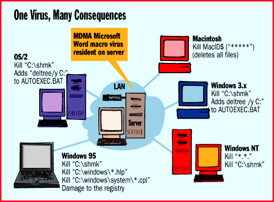
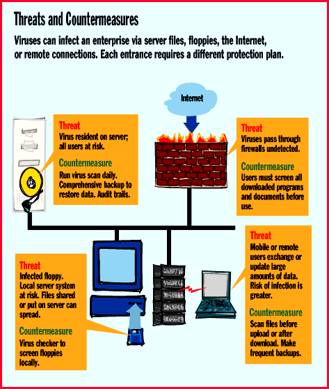

# Keep Networks Safe from Viruses

*Features*

Your network can spread viruses, but it can also help get rid of them. Here's how.

Barry Nance

The movie Independence Day showcased some clever humans defeating aliens by planting a virus in the alien mother ship's computer. The ship -- the biggest file server ever -- suffered physical damage and crashed. Obviously, the aliens hadn't heard of antivirus software.

Couched in a large dose of poetic license, this entertaining science fiction tale brings computer viruses to our attention yet one more time. Here on earth, computer viruses are a real threat to your data and your networks -- but aliens aren't the culprits. Rather, a few individuals feel the need to distribute deliberately buggy software.

Viruses have been a problem for years, of course, but their threat is heightened today because of our growing interconnectedness. We now regularly share files on servers, download files from the Internet, and accept attachments to e-mail messages. Any one of these everyday activities can load buggy software into our computers. And no form of computer file seems to be immune. Java applets, ActiveX components, and word processing and spreadsheet files all can -- and do -- contain viruses.

Fortunately, there is help. A comprehensive backup plan and centralized antivirus scanning can reduce viruses to minor annoyances.

Network Vulnerabilities

Encountering a virus is riskiest on a network because of the indiscriminate way that people share executable files and data files alike through the file server. Combine inadequate data backups and a virus that's allowed to go unchecked for a period of time, and the cost to your organization in lost data and wasted time can be enormous.

Most organizations encourage the use of antivirus tools, but virus awareness is often left for individual departments or remote offices to administer. This is a mistake. Centralized, enterprise-wide virus detection and reporting are important, and for an important reason: An organization must know quickly whether it's dealing with an isolated virus incident so it can keep the cost of antivirus measures commensurate with the level of threat. The most effective antivirus procedures are those that apply to an entire enterprise, use the organization's network to report any problems, distribute antivirus software updates over the network, and, via the use of log-in scripts, enforce the regular use of antivirus software.

But even before you can deal effectively with the problem by launching an enterprise-wide plan, you've first got to cut through all the vocabulary and euphemisms that have sprung up around viruses. Repeat after me: A computer virus is a buggy program that executes on the computers attached to your network. It's not a germ; viruses don't spread the way germs do. A virus simply copies itself through the file system on your computer or file server.

An antivirus utility does not "inoculate" your system or "disinfect" your PC. It scans for known virus programs, removing buggy programs and their effects using normal file- or disk-management operations. And what seems like an "outbreak" is not a contagious epidemic, but rather the result of a virus reading your computer's clock and taking some sort of action (erasing files, perhaps) on a certain date.

A computer virus is not self-aware. When an unsuspecting victim executes a program containing a virus, the virus program or program segment copies itself to another program file. The target program is typically an executable file, but it can also be the master boot record of the hard disk. The new copy of the virus in the infected program also inherits the ability to copy itself when run.

Some viruses do nothing else but make copies of themselves. Or they might simply display a message on a certain date. But others are not so benign -- they strike by changing or deleting your files.

It's a popular misconception that viruses affect only DOS-based computers and that protected-mode systems, such as OS/2, NT, and Unix, are immune. But viruses can attack these OSes. Viruses designed to infect native OS/2 executables are more complicated to write than their DOS counterparts. However, dual-boot OS/2 systems that occasionally run DOS are subject to the thousands of DOS-based viruses. These buggy programs can alter boot records and DOS program files on OS/2-based machines.

In addition, we know of two OS/2 viruses: OS2vir1 and Jiskefet. OS2vir1 replaces all EXE files in the current directory with copies of itself. As a result, this virus is hard to overlook and thus does not spread very far. OS2vir1 displays messages identifying the files that it's replacing as it runs.

Jiskefet replaces EXE files with a new file that contains the original EXE file. When the new, infected file is executed, it re-creates the original EXE file under another name and then executes the original file. Jiskefet is not particularly effective at finding new files to infect. Similar viruses in the DOS world have never spread exceptionally well, which suggests that Jiskefet will not pose any significant threat to OS/2 systems.

Both Windows 95 and NT are fertile ground for the spread of DOS viruses, as well as viruses specially targeted for Microsoft's two latest OSes. Every unique OS requires individually tailored antivirus-protection software.

Viruses that infect files typically install themselves as memory-resident TSRs. Win 95 and NT support TSRs running in DOS sessions. These memory-resident viruses can infect new programs or floppies as they are used. Some file-infecting viruses fail in the NT (and OS/2) environment because they attempt to use undocumented and unsupported DOS features. A memory-resident virus can't spread directly between separate DOS sessions, but any program executed in a DOS session that's running a virus will likely become infected.

OS/2 programs use an executable file format that's different from that of ordinary DOS programs. A file-infecting virus that treats an OS/2 or NT executable file like a DOS file will likely render the target program inoperable. In some cases, starting an OS/2 program from within an infected DOS session will infect the program's DOS stub (the part of an OS/2 program that prints "This program cannot be run in DOS mode").

Word processor and spreadsheet macro viruses are nasty cross-platform problems. The destructive MDMA macro virus infects Microsoft Word documents and has the capability to delete files (see the figure

"One Virus, Many Consequences"

). Because this virus is application-based, it works across many platforms: OS/2, Windows, Win 95, NT, and the Macintosh. MDMA infects NORMAL.DOT as well as files that use the AutoClose macro.

MDMA activates itself on the first day of the month. The result of an MDMA attack is different on different OSes. A typical effect: After the damage is done, MDMA displays the following text in a message box: "You are infected with MDMA_DMV. Brought to you by MDMA (Many Delinquent Modern Anarchists)."

LAROUX is a another macro virus; it infects Microsoft Excel spreadsheets. LAROUX replicates itself but does not destroy data. It has been reported by only one company, at sites in Alaska and Africa.

The LAROUX virus infects the PERSONAL.XLS file, which is located by default in \MSOFFICE\EXCEL\XLSTART. PERSONAL.XLS is a default filename similar to NORMAL.DOT for Microsoft Word for Windows. If this file does not exist, the virus creates it.

LAROUX uses two macros to replicate: auto_open and check_files. It infects Excel versions 5 and 7 on Windows 3.1, Win 95, NT, and OS/2. Because of the way it searches for PERSONAL.XLS (which is a DOS filename), the virus does not replicate on the Macintosh.

Viruses can spread on any system on which a program can create or modify another program. And they can spread between users anytime a program that one user runs can create or modify a program that another user can run.

Viruses aren't typically network-aware, but there are two notable exceptions. In November 1988, an Internet worm infected thousands of Unix-based machines that were connected to the Internet. And the CHRISTMA EXEC, a Rexx program for IBM 's VM OS, produced millions of copies of itself on computers attached to European university networks, as well as IBM 's own computers. In both cases, the network structure enabled the programs to spread rapidly in a matter of hours. Within a day or so, network administrators waded in, disabling the programs and cleaning up the mess.

Recommended Dosage

So how do you stop viruses from attacking your enterprise? Stopping your work every 10 minutes to run an antivirus utility is unproductive. But running such a utility just once every few years is a wasted effort. For most organizations, balancing safety and productivity means running antivirus software as frequently as once a day or as little as once a week. If your employees frequently use floppies or other uncontrolled media to transport data, running such a utility daily makes sense (see the figure

"Threats and Countermeasures"

Unfortunately, the majority of antivirus programs are outdated even before you install them; IBM estimates that up to five new viruses are written each day. Updates thus form an important part of any antivirus policy. A typical organization should plan to update its antivirus software at least every quarter.

To remind you of your potential exposure, many antivirus programs will announce their staleness when a certain date is reached. Distribute updates soon after the utility displays its out-of-date message, but let users know that it's OK to run a utility that claims it's a few months out of date. Be sure to distribute updates to all your sites on a timely basis.

You should require 100 percent compliance with your antivirus procedures. If you achieve 90 percent, then you will have a fairly effective antivirus program in place. If your network OS (NOS) is NetWare, consider running the antivirus utility in NetWare's system log-in script. Each computer will then scan for viruses every time a user logs on to the network. DOS, Windows 3.1, Win 95, the latest version of NT, and OS/2 all support NetWare log-in scripts.

No Immunity

Inevitably, every organization will encounter a virus problem. Networked computers, especially those running DOS or Windows, are most at risk. Networks allow viruses, the majority of which are DOS-based, to spread quickly.

However, no computing environment has a natural immunity to viruses. A good backup of your data, along with an aggressive enterprise-wide antivirus strategy, is inexpensive insurance.

## Where To Find

Cheyenne Software

Roslyn Heights, NY

Phone: (516) 484-5110

Fax: (516) 484-3446

http://www.chey.com

Internet:

http://www.chey.com

## IBM

Armonk, NY

Phone: (914) 765-1900

http://www.ibm.com

Internet:

http://www.ibm.com

Intel Corp.

Santa Clara, CA

Phone: (408) 765-8080

http://www.intel.com

Internet:

http://www.intel.com

McAfee Associates

Santa Clara, CA

Phone: (408) 988-3832

Fax: (408) 970-9727

http://www.mcafee.com

Internet:

http://www.mcafee.com

!S&S Software International, Inc.

Burlington, MA

Phone: (617) 273-7400

Fax: (617) 273-7474

http://www.drsolomon.com

Internet:

http://www.drsolomon.com

Symantec Corp.

Cupertino, CA

Phone: (408) 253-9600

http://www.symantec.com

Internet:

http://www.symantec.com

TCT-ThunderByte Corp.

Cornwall, Ontario, Canada

Phone: (613) 930-4444

http://www.thunderbyte.com

Internet:

http://www.thunderbyte.com

Touchstone Software

Huntington Beach, CA

Phone: (800) 531-0450

http://www.antivirus.com

Internet:

http://www.antivirus.com

## One Virus, Many Consequences

Once a macro virus, such as MDMA, infects a server, it can create cross-platform havoc throughout an organization.

## Threats and Countermeasures

mailto:"barryn@bix.com"

Barry Nance, a BYTE consulting editor, has been a programmer for 25 years. He is the author of Using OS/2 Warp (Que, 1994), Introduction to Networking (Que, 1994), and Client/Server LAN Programming (Que, 1994). You can contact him at

barryn@bix.com

## Images

