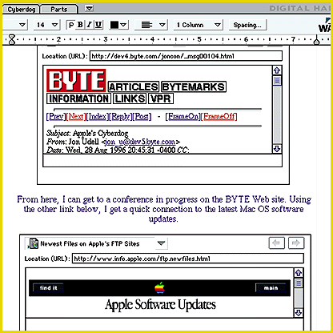

# Componentized WAV of the Future

*Reviews*

An OpenDoc word processor delivers on component software's promise of small, tightly coupled parts.

Tom Thompson

Is Apple's cross-platform OpenDoc technology celebrates its first birthday, practical component software is starting to appear. One such component is

Digital Harbor's WAV

, which implements the bread-and-butter task of word processing. I saw a preliminary beta version. Currently, only a Power Mac version is available. As beta software, WAV has some rough edges and missing features, but it proves that OpenDoc's component-based architecture is sound.

At 1.5 MB, WAV offers a lean-and-mean set of features. That's fine: I don't want unnecessary wizards and other "features" that contribute to code bloat. For text, you get basic formatting, where you pick a typeface, style it (bold, italic, underline, and a color), and align it with a few points and clicks. WAV has a simple word-count command, a handy feature if you write to length. It does have advanced layout facilities, such as arranging the text into columns (a maximum of five) and the ability to tinker with the text spacing. To readily get at existing text, WAV has conversion filters for WordPerfect 3.x, Word 4.x, and Word 5.x files.

A FolderBay function consolidates operations or content into virtual "folders" with clickable tabs at the top of the document window. Default folders are text functions, CyberDog (Apple's Internet tool suite), and a parts folder for additional OpenDoc components (e.g., a draw editor part or a bit-map editor part). You can add your own "project" folder tab to consolidate work documents.

As an OpenDoc component, WAV takes a document-centric approach to creating and handling data. You don't launch WAV itself. Instead, you open a WAV stationary (or template) file to make a new document. A Document Info command lets you set each document's file type (e.g., WAV format or ASCII text) and memory size, so you can conserve memory by adjusting it to suit the document.

WAV integrates well with other OpenDoc parts. If you have CyberDog installed, its functions are immediately available from WAV's CyberDog tab. More important, you can drag and drop Internet uniform resource locators (URLs) and graphics from CyberDog into a WAV window, and save the information into a live document. When you next access the file, CyberDog automatically connects to the Internet and fetches the URL's current information.

For example, I have a WAV file that points to a conference on BYTE's Web site pertaining to CyberDog discussions. When I'm notified of new messages in this conference, I just open the WAV document, and I'm automatically positioned at the last-read message. Conventional Web browsers do this with bookmarks, but WAV does them one better: It lets you capture links, text, and graphics into documents, bypassing the usual download, file-conversion, and import stages.

Because OpenDoc components are small and tightly focused, development costs are lower. Thus, WAV costs only $49. While you couldn't publish a book with it, you can crank out sophisticated publications with embedded images, diagrams, tables, and charts -- thanks to the OpenDoc components that make WAV greater than the sum of its parts. Also, WAV represents the future of on-line publishing, where you build documents with dynamic links to information on the Web. WAV has no equal in this area.

## Product Information

WAV................................$49

5 (requires a Power Mac or compatible system running

" System 7.5.1 and OpenDoc 1.0.4)

Digital Harbor

Lindon, UT

Phone: (801) 785-2115

Fax: (801) 785-2414

http://www.dharbor.com

Internet:

http://www.dharbor.com

Circle 1069 on Inquiry Card.

## Ratings

Technology *****

Implementation ***

Key

***** Outstanding

**** Very Good

*** Good

** Fair

* Poor

## WAV of the Future

TWAV's tight Internet integration lets you build documents containing live updates.

mailto:"tom_thompson@bix.com"

Tom Thompson is a BYTE senior technical editor at large. You can contact him at

tom_thompson@bix.com

## Images

