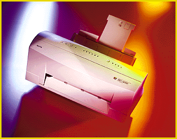

# Waterproof Color That Lasts

*Reviews*

_Alps' MD-4000 prints high-quality, high-resolution color images, indelibly and inexpensively.

Robert L. Hummel

Boasting inexpensive, high-quality color printing, Alps Electric hopes that its new $499 MD-2010 color printer and $699 MD-4000 printer/scanner will ride the current wave of interest in PC-based photo-realistic imaging. Using Alps' thermal-transfer "Micro Dry" inks, these units print waterproof, high-resolution color images (600 by 600 dpi in color, 1200 by 600 dpi in monochrome) affordably, though slowly, for systems running Windows 3.x and 95.

I tested the MD-4000 in a Windows environment. The MD-4000 resembles the MD-2010, but within it is a 24-bit, 600-dpi, TWAIN-compatible, sheet-feed

color scanner

x, which makes it an affordable one-package solution for image acquisition and printing. Alps also offers a Mac version.

With four snap-in ribbon cartridges, the MD-4000 supports hands-off CMYK printing. The printer determines the position of each cartridge. If a needed color isn't loaded, the printer prompts you for it. A $6.60 ribbon produces about 35 to 40 pages at 100 percent coverage. Alps also offers 20-page metallic ribbons (gold, cyan, magenta, and silver) for $8.99 each.

Alps claims that the MD-4000 doesn't require special paper, and my testing bore this out. I printed full-color images on copy paper, postcards, iron-on T-shirt transfers, transparencies, and photographs, as well as other coated papers, with good to excellent results. The MD-4000's multipass print engine shows minor banding only on large expanses of CMY-composite black. The printer's default color-matching produced acceptable-looking prints, and the Windows driver gives you ample opportunity to fine-tune the output.

The MD-4000's pluses are quality and affordability; speed is the minus. It took 8 minutes to print an A4-size color image at 600 dpi. Reducing image size or density accelerates the printing process proportionally. Text prints at a page per minute. Mechanically, the printer is less than rugged. A bevy of pull-out, flip-down, and sliding trays, drawers, and compartments invite accidents. I also found the feeder tray somewhat finicky.

To scan a document, you must place it in a plastic envelope -- a 4- by 6-inch unit for small documents and photos or an 81

2- by 14-inch unit for larger media. The Alps Copy Studio software provides bare-bones service. For anything beyond color copying, you'll want to scan from your own TWAIN-compatible image editor. Alps includes Adobe's consumer-oriented PhotoDeluxe with the MD-4000.

The MD-4000 printer isn't likely to find a home in a high-production photo studio. But for the small office or home, the attraction is clear: durable, high-quality color printing and high-resolution scanning at an affordable price.

## Product Information

MD-4000........................$699 (estimated street price)

Alps Electric, Inc.

San Jose, CA

+Phone: (800) 825-2577 or (408) 432-6000

Fax: (408) 432-6035

http://www.alpsusa.com/

Internet:

http://www.alpsusa.com/

Circle 1070on Inquiry Card.

## Ratings

Technology ****

Implementation ***

Performance **

Key

***** Outstanding

**** Very Good

*** Good

** Fair

* Poor

## Alps Goes Printing One Better

mailto:"rhummel@monad.net"

]Robert L. Hummel is an electrical engineer, programmer, and consultant. You can reach him at

rhummel@monad.net

## Images

