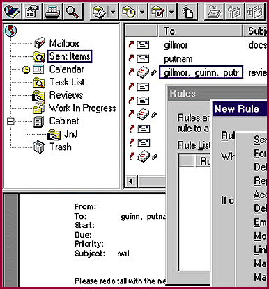

# GroupWise Sends a Message

*Reviews*

With its latest GroupWise release, Novell goes head-to-head with groupware giants Lotus and Microsoft.

Steve Gillmor

Choosing the right groupware product is harder now with the release of Novell's

GroupWise 5

(hereinafter GW5), which adds significant document management tools to an already feature-laden messaging product. The new version also has state-of-the-art NetWare Directory Service (NDS), TCP/IP client/server technology, OLE automation, shared folders, and an enhanced interface.

We installed the GW5 beta on a NetWare 4.1 server, using NetWare Administrator 4.1.1. An included two-user version of NetWare 4.x gives access to NDS tools. Initially, GW5 runs only on Windows NT Server. Setup went smoothly. The GroupWise Setup Adviser walks you through extending the NDS tree; defining domain, post office, and agent names, locations, and contexts; and adding current users or new ones.

The GW5 client adopts a three-pane interface, like cc:Mail, Lotus Notes, and Microsoft Exchange. The left window displays the folder list. You can organize multiple item types by subject or by project in folders within cabinets, and sharing folders is easy.

GW5 leads the pack in document management. Novell has integrated much of its Soft Solutions product, including document check-in, check-out, versioning, sharing control, version-level security, and an activity log. Documents are stored in libraries, and mailboxes display only references to documents.

GW5 adds client/server connectivity while maintaining its drive-mapped access to the post office to ease migration and use existing hardware. GroupWise's proxy capability lets users access other mailboxes in different post offices.

With GW5 you can convert items from one type to another -- for example, mail messages to calendar appointments. You can track message status by right-clicking a mailbox item and viewing its properties. You can also see incoming and outbound messages in a threaded view. You can create a rule to move items into folders, and you can define trigger events that let rules execute on a server -- when you're away, for instance.

GroupWise offers a complete toolkit for messaging, calendaring, scheduling, and managing documents. It also gives you tools for single-point NDS-based administration. The package represents a tremendous value for existing NetWare shops. Its ease of use and configurability compete favorably with Exchange, but its Web integration lags behind Notes' Domino technology. And with Windows NT gaining fast on NetWare, the network administrator must think twice before making the leap to GroupWise.

## Product Information

GroupWise 5........................Starts at $718 (5 users)

% (Server requires Windows NT Server

, running NetWare 4.1.1. Clients available

* for NT, Macintosh, PowerMac, Unix, and

Windows 3.x, 95, and NT.)

Novell Corp.

Orem, UT

,Phone: (800) 453-1267 or (801) 222-6000

Fax: (800) 453-126

http://www.novell.com

Internet:

http://www.novell.com

Circle 1068 on Inquiry Card.

## Ratings

Technology *****

Implementation ****

Key

***** Outstanding

**** Very Good

*** Good

** Fair

* Poor

## Still to Come

The initial release of GroupWise 5 does not include everything we'd

/hoped for. Here are a few important omissions:

K Novell's GroupWise WebAccess supports busy searches and virtually all of

H GroupWise's client functions via the Internet, but this isn't bundled

into GW5.

A You can't create custom icons for specific URLs in the mailbox.

* Unix and OS/2 versions are in the works.

E Promised work-flow tools won't ship until a later, interim release.

"Another Wise Solution from Novell

Novell's GroupWise lets you use drop-down menus to select event types, condition filters, and actions.

mailto:"sgillmor@aol.com"

Steve Gillmor, of Southern Digital, has extensive experience with groupware applications. You can reach him at

sgillmor@aol.com

## Images

