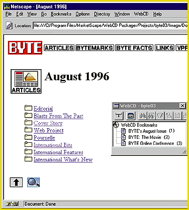

# Hybrid Web/CD-ROM: Do It Yourself

*Reviews*

[MarketScape's WebCD packages Web content for off-line use and automates CD-ROM mastering.

Jon Udell

Why bother with CD-ROMs in the Web era? There are lots of reasons. Try hosting an 8-minute video on your Web site. Try asking your sales force to demonstrate your site to non-Web-connected clients. Try using your site's content on an airplane. You can solve all these problems with MarketScape's WebCD.

CD-ROMs that venture on-line to augment static content with live updates have been around for a decade. MarketScape calls it the "big CD, small Web" model. WebCD heralds a new era -- big Web, small CD. It acknowledges the primacy of the Web. It delivers a native Web-browsing experience and adds value to that experience by facilitating the effective use of high-bandwidth content, off-line access to all packaged content, seamless Web integration when on-line, and content aggregation across multiple sites.

To build a site image, you run WebCD Packager, a Windows 95 application that integrates a Web crawler, a browser, and a CD-ROM-mastering utility. Point it at your Web server -- or even several of your servers, or any servers anywhere (be careful!) -- and scoop up the content you need. As you construct a package, you can browse it live -- no waiting until the build finishes before you can view it.

To distribute the image, you deliver it -- on a CD Recordable (CD-R) disc, tape, or conceivably by way of FTP -- to a mastering shop. The image contains all your Hypertext Markup Language (HTML), GIF, Audio Video Interleave (AVI), and other files, mapped to the eight-dot-three filename convention required by ISO-9660 and optimized for the peculiar access behavior of CD-ROM drives.

The image also contains a setup program that installs WebCD Viewer. It's a wrapper that will find and integrate with Netscape Navigator or Microsoft Internet Explorer, adding to either browser a floating window that controls special WebCD search and bookmark functions. Mac and Unix users miss out on WebCD Viewer. However, they can point their browsers directly at the data.

I tested WebCD Packager on The BYTE Site. The image I built (

see the photo

) combines articles from our document server with messages from our conference server. When you aggregate content across multiple Web servers (or sites), where's the home page? You can choose an existing one or make a new one, but either way, you'll want WebCD Viewer's bookmarks to call out landmark pages.

I discovered a few glitches. Although it supports proxy servers, WebCD could not tunnel through our multiple-proxy setup. Because it interleaves uniform-resource-locator (URL) discovery and retrieval, I found it tricky to map out our whole site before choosing what to package. Also, when I ran my first build, some links resolved on-line rather than locally. I'd have liked a verification tool to ensure that all referenced pages were included in the package. You wouldn't want to find on-line dependencies after you mastered your CD-ROM.

Its minor immaturities aside, WebCD is an outstanding tool that I recommend highly. There's no easier or better way for marketers to transform a company's Web site into a distributable, stand-alone, high-impact presentation.

## Product Information

WebCD 1.0............................$975

MarketScape, Inc.

Colorado Springs, CO

+Phone: (888) 469-3223 or (719) 593-9890

Fax: (719) 532-0165

E-mail: info@marketscape.com

http://www.marketscape.com

Internet:

http://www.marketscape.com

Circle 1065 on Inquiry Card.

## Ratings

Technology *****

Implementation ****

Key

***** Outstanding

**** Very Good

*** Good

** Fair

* Poor

## Dynamic Meets Static Seamlessly

WebCD lets you seamlessly integrate live Web pages with static pages and high-bandwidth data types such as video.

mailto:"judell@bix.com"

Jon Udell (

judell@bix.com

,) is BYTE's executive editor for new media.

## Images

