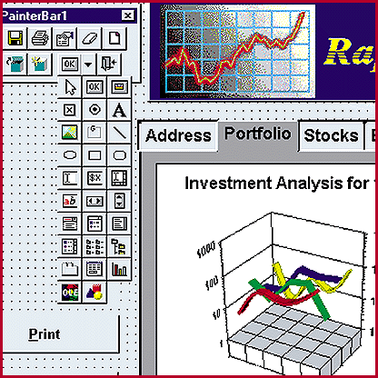
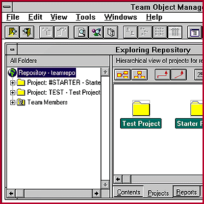

# Upgraded C/S Tools: How Much Better?

*Reviews*

New versions of PowerBuilder and Centura offer improved performance and faster 32-bit applications.

Mark Hettler

Earlier this year, we compared Borland International's Delphi Client/Server Suite, Microsoft's Visual Basic 4.0 Enterprise Edition, Powersoft's PowerBuilder Enterprise 4.0, and Gupta's SQLWindows 5.0 (see "New Leaders of the Client/Server Migration," June BYTE). Since then, Powersoft has released PowerBuilder 5.0, while Gupta has changed its name to Centura Software and issued Centura Team Developer 1.0. These products are so improved that we considered it important to look them over and update our previous ratings based on the new capabilities.

Both of these packages are development tools for creating custom, stand-alone client/server applications that let users enter, sort, filter, and report on your organization's data according to your business policies, procedures, and data operations. As in June, we tested these products for performance, usability, and versatility, using each one to develop an order-entry-system database of books, authors, and customer orders. With our test applications, users browse a database of 50,000 existing orders, enter new orders, and run simple and complex reports.

In our tests, PowerBuilder and Centura come out close together. PowerBuilder is a little easier to use and a little more powerful, but Centura builds better-performing applications more quickly. In the June review, Delphi showed itself to be several times faster than Visual Basic, which in turn was several times faster than its other competitors. Centura and PowerBuilder have narrowed the gap, but Visual Basic is still a solid second.

Using NSTL's overall ratings scheme, Centura's greatly improved performance and PowerBuilder's much better versatility move both products within striking distance of Visual Basic. In fact, on the 1-to-10 scale we use, a mere 0.2 delta separates the three runners-up. Though it's a good performer, Visual Basic is clearly on a tier below the other three products in terms of features. Delphi, though it has the steepest learning curve, is still the performance and features champ.

Most of the features and architecture that have made

PowerBuilder

popular are still in place in version 5.0. You still use interfaces called painters to create the various parts of applications, and DataWindows allow easy implementation of database access. InfoMaker, the report generator, looks and feels much the same as in PowerBuilder 4.0, but it's now available as a 32-bit application. Developers can create reusable components called user objects, which can be based on built-in components or other user objects and inherit their properties.

Beyond the familiar features, however, version 5.0 moves the product into the next generation of client/server development by introducing support for a three-tiered architecture. This capability is already available in Visual Basic and Delphi, but PowerBuilder is the best of the three products at providing step-by-step instructions for developing client and server applications that communicate with each other. Powersoft introduced nonvisual user objects in version 4.0. It extended the capability in version 5.0 to allow the nonvisual objects of one program to be executed by another.

Users familiar with PowerBuilder's Library Painter will go through virtually no additional learning curve with the new version-control system, ObjectCycle. Once you set up an ObjectCycle Server, you simply register the contents of a library with ObjectCycle. From that point, you check components in and out as in earlier versions. Setting up the ObjectCycle Server is effortless. This is amazing given that the system must create a client/server database to store project data.

The company that was formerly known as Gupta has adopted a completely new identity, renaming both its flagship software package and the company itself. Inside the new package, however,

## Centura Team Builder

is essentially a version upgrade of SQLWindows. You still develop applications by writing code in the familiar Outliner interface, using the same SQLWindows Application Language (SAL) commands and functions that earlier versions used.

Developers can avoid the Outliner to a large degree by using QuickObjects, which generate forms and other objects automatically based on input supplied by the developer. This isn't a new feature, however, having been introduced in SQLWindows 5.0. The Team Object Manager is essentially Team Windows with a new user interface. Centura's much-touted Application Server, the tool for developing three-tiered applications, won't be available until later in the year.

The earlier version's annoying details are also still in place. To enable access to remote databases, you must still edit configuration files manually. Team Object Manager, like the earlier Team Windows, still leads the field in maximizing the power of the client/server environment for repository-based applications management, but it's still poorly integrated with the main development interface. Also, while QuickObjects produce applications and components more quickly than writing code in the Outliner, it is difficult and confusing to change properties after you generate them.

With all these holdovers, why did we bother with Centura? Its major new feature is that it now supports the development of 32-bit applications, a change that significantly improves performance (see the section below). In addition, the package incorporates Centura Ranger for database replication. Many leading database vendors (e.g., Oracle, Sybase, and Microsoft) support replication. Centura's strategy is to approach the issue from the client side, providing heterogeneous replication between a variety of database formats. At present, however, it supports only SQLBase and Oracle databases; replicating Oracle databases requires buying an additional product from Centura.

## Performance

NSTL ran PowerBuilder 5.0 and Centura Team Builder through the same benchmark suite used in the June review, with the identical configuration: We executed applications on a Dell Dimension XPS P90 with 24 MB of RAM running Windows NT 3.51, accessing a Microsoft SQL Server database. This allowed us to compare the results directly to those of the June review, where PowerBuilder and SQLWindows trailed Delphi and Visual Basic by significant margins.

Both products are markedly faster, but Centura is by far the more significantly improved. This is due largely to its 32-bit capability; the previous 16-bit version was at a disadvantage to the other three products in the earlier review. However, data retrieval is dramatically improved as well. The time to retrieve a 50,000-record data set is 80 percent shorter. Report generation takes a third less time for a complex report, more than half for a simple report. These improvements are enough to move Centura ahead of PowerBuilder, though it's still well behind Delphi and Visual Basic.

PowerBuilder has introduced a new machine code compiler. By Powersoft's own admission, however, the benefits for such operations as data retrieval and screen drawing -- which are, after all, the central facets of an on-line database application -- will be minimal at best.

Nonetheless, PowerBuilder 5.0 shows a consistent 20 percent to 30 percent increase over version 4.0 on most of the tests. Report execution times are reduced by more than a third, largely because the InfoMaker report generator is now a 32-bit application.

In the final analysis, PowerBuilder beats Centura (despite the latter's improvements), and neither beats Delphi for features and performance.

## Where To Find

Centura Team Developer 1.0....................$4995

'(486 or better, 8 MB of RAM, 80 MB of

&disk space, Windows 95 or Windows NT)

Centura Software Corp.

Menlo Park, CA

Phone: (800) 444-8782

Fax: (415) 321-5471

http://www.centurasoft.com

Internet:

http://www.centurasoft.com

Circle 1004 on Inquiry Card.

4PowerBuilder Enterprise 5.0...................$2995

((486 or better, 12 MB of RAM [16 MB is

$recommended], 32 MB of disk space,

)Windows 3.1x, Windows 95, or Windows NT)

Powersoft Corp.

Concord, MA

+Phone: (800) 395-3525 or (508) 287-1500

Fax: (508) 369-8639

http://www.powersoft.com

Internet:

http://www.powersoft.com

Circle 1005 on Inquiry Card.

## PowerBuilder 5.0

## Ratings

Technology ****

Implementation ****

Performance **

Key

***** Outstanding

**** Very Good

*** Good

** Fair

* Poor

## ADVANTAGES

,+ Integrated version-control system that's

remarkably easy to set up

-+ Excellent support for three-tiered client/

. server applications that communicate with

one another

DISADVANTAGES

)- Repository platform requires Sybase's

SQL Anywhere

*- Improved performance still lags behind

the competition

## Centura Team Builder

## Ratings

Technology ****

Implementation ***

Performance ***

Key

***** Outstanding

**** Very Good

*** Good

** Fair

* Poor

## ADVANTAGES

+ Much improved performance

)+ Allows building of 32-bit applications

++ Data repository uses Oracle, Microsoft,

Sybase, or Centura databases

DISADVANTAGES

'- Features and versatility are little

changed

'- Application Server for three-tiered

% applications is not yet available

,- Need to manually edit configuration files

## PowerBuilder vs. Centura

You can access the full data, including Delphi and Visual Basic 4.0,

Dcomplete with individual weightings and scores in each category and

http://www.byte.com/art/download/download.htm

line item, on The BYTE Site (

-http://www.byte.com/art/download/download.htm

? PowerBuilder Centura

Form Design

<Visual query builder Y Y

-Query by form Y

<Quick form from database table Y Y

<Move fields after generating Y Y

<Quick master-detail form Y Y

<Multiple record display Y Y

Application-Control Features

<Dynamic menu building Y

<Multitab dialog boxes Y Y

<Form can call another form Y Y

Event Handling

<Procedures triggered by events Y Y

<Detect keystroke/mouse-click/time event Y Y

=Process based on old or new value Y Y*

<Cancel any event Y Y

Advanced Functions

<Incorporate VBX and ActiveX controls Y Y

<OLE 2.0 edit-in-place Y Y

<Store OLE objects in database Y Y

SQL Support

<Generic SQL Y Y

<Engine-specific native SQL Y Y

%Transparent joins across engines

Report Generator

<Incorporate report into application Y Y

<Quick report within application Y Y

<Specify selection criteria, sort Y Y

order at run time

<Event procedures Y Y

<Multiple records across page Y Y

Application Repository

<Store application components Y Y

and reusable objects

<Store multiple versions Y Y

<Store form/report templates Y Y

Workgroup Features

<Check out/check in Y Y

=Built-in version control Y Y

<Version control of external files Y Y

## Remote Automation

-Produce remote programs Y

<Call and exchange data with Y Y

remote programs

-Remote procedures can access database Y

<Call in-process OLE server Y Y

<Call out-of-process OLE server Y Y

-Produce in-process OLE servers Y

Object Management

<Copy objects between applications Y Y

<Copy code snippets between applications Y Y

<Reusable object classes Y Y

<Subclasses with inheritance Y Y

<Multiple inheritance Y

6* By retrieving status codes from database.

Y = yes

## PowerBuilder 5.0

## Centura Team Builder

mailto:"markh@nstl.com"

Mark Hettler is a senior technical editor at NSTL. You can reach him at

markh@nstl.com

## Images

