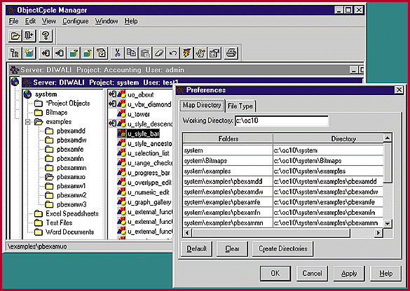

# New Versions, New Controls

*Reviews*

In any development environment that involves more than one person, the issue of version control (sometimes called change control) becomes critically important. As a software project evolves and grows, you add and change routines and modules, requiring recompilation, relinking, and resynching of some or all of the executable files.

Both PowerBuilder Enterprise and Centura Team Developer include facilities for version control, and both use client/server database technology to create and manage a shared, central object repository. Centura's Team Object Manager lets developers choose from Oracle, Microsoft, Sybase, or Centura databases for a repository platform, while PowerBuilder's ObjectCycle requires Sybase's SQL Anywhere.

Object-based systems must store many types of objects together with their properties and histories, including windows stored in libraries, menus, ActiveXes, bit maps, icons, DLLs, and even Word documents. Centura Team Developer features a graphical class browser that visually describes inheritance relationships among objects and classes, management reports that detail where an object is used in an application, ownership information on objects, the assignment of separate roles to team members who function as class engineers or object assemblers, version control of objects, and much more. PowerBuilder has ObjectCycle Manager (

see the screen

), a graphical interface to the ObjectCycle Server that provides administration of PowerBuilder objects and projects, and version control for non-PowerBuilder objects. Centura's Team Object Manager supports project branching (e.g., running development for versions 1.1 and 2.0 concurrently), coding standards management, deployment management, impact analysis, audit trails, and management reporting.

Important tasks related to version control include the administration of multiple platform versions, configuration information, build management, quality control, and release management. Both companies claim that their version-control facilities are up to the complete task. For example, PowerBuilder has a build process that's quite different from that used in a C or C++ environment. Third-party tools have only a limited ability to handle such product-specific, cross-tool builds, and that can limit their usefulness and versatility. Centura has a build management feature with which you can specify how different files come together to constitute a deployable application.

$ObjectCycle Manages Version Control

## Images

