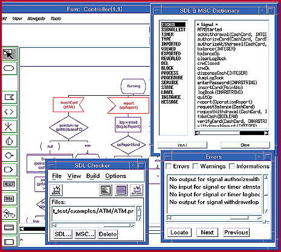

# Real-Time RAD

*Reviews*

ObjectGeode, an OO CASE tool for real-time development, is a suite of tools based on accepted standards.

Rick Grehan

Object-oriented (OO) CASE tools have been notoriously deficient when applied to real-time applications. Now, Verilog's ObjectGeode, with its triad of interwoven editors, will take on this real-world challenge.

Opponents of generic OO methodologies complain that they are not effective in modeling the asynchronicity, concurrency, and distribution of real-time systems, and that typical OO CASE tools provide no formal connection between abstract models and programs.

Consequently, ObjectGeode has some rapids to cross. It does so by lashing together a collection of tools based on well-accepted standards.

Editors, Editors

I tested ObjectGeode on a SparcClassic running Solaris 2.5. It is also available for SunSparc, Hewlett-Packard Series 9000/7xx-8xx, IBM RS/6000 and PowerPC, and DEC Alpha/OSF1.

At ObjectGeode's core are three editors: object modeling technique (OMT), specification and description language (SDL), and message sequence chart (MSC). The OMT editor is sometimes referred to as the class diagram editor. Each editor's notations are based on widely accepted standards: SDL and MSC are standard notations in the telecommunications industry. OMT is the well-known technique developed by James Rumbaugh and others.

The OMT Editor

This editor allows you to build class and instance diagrams using OMT notation. From within the OMT editor, you make sets of modules, each module being a particular view of the system. Typically, you create an overall view of the system to identify the principal actors (i.e., objects) and then construct other modules that describe those actors in increasing detail.

Diagrams you construct with the OMT editor are necessarily visual and fall into two categories: class diagrams and instance diagrams. Class diagrams show the internal structure (i.e., data items and methods) of -- and relationships between -- the system's objects. For example, if you are designing a system to control a bank's ATMs, you would use a class diagram to define what's inside the system's notion of a bank object and how that object relates to a customer object. Instance diagrams illustrate how a particular set of instances derived from the system's classes might be logically connected to one another.

ObjectGeode can generate C++ code from the modules you create in the OMT editor. This code is really C++-style-header files containing class declarations filled with variable definitions and method prototypes. You can't use the OMT editor to specify the details of a given class's methods.

The MSC Editor

You turn to the MSC editor to diagram each use case, which is like the script of a play. You can read use-case diagrams to determine the actions that unfold as the system operates.

Other methodologies call use cases usage scenarios or event traces. But ObjectGeode scenarios refer to high-level event descriptions that are separate from the low-level details of the event. Thus, a scenario might be shown as a block labeled SCSI read in an MSC diagram, while the MSC would be the chart detailing the steps of the read operation.

It's important to note that the charts you build with the MSC editor show discrete activities, so you cannot use it to model the entire behavior of the system. Additionally, MSCs show the expected behavior of the system -- what the system is supposed to do, not how it does it.

Use cases are helpful in determining derived requirements of objects. In other words, working out the use case for a particular event may reveal an attribute that was omitted from an object participating in that event. It's a two-step process. First, you identify the functions the system must perform; next, you work through the details of the lowest-level activities.

The SDL Editor

ObjectGeode's

## SDL Editor

is a combination of three editors: a hierarchy editor, an interconnection editor, and a finite-state-machine (FSM) editor. The hierarchy editor is similar to one found in the MSC editor and is likewise a means of grouping similar activities.

With the interconnection editor, you can model communication between objects in the system like in a wiring diagram. It's easy to get confused here, because you're likely to conclude that objects in the SDL editor are the same as those you built in the OMT editor. This is not so, and the distinction is revealed once you understand ObjectGeode's design process. Simply put, you use the OMT editor in the problem domain and the SDL editor in the solution domain. Thus, SDL editor objects are often artifacts -- objects that are constructed to solve the problem outlined in the OMT editor.

You program the machinations of the processes themselves visually, using the FSM editor. From a distance, you could mistake the FSM diagrams for flowcharts, which in a sense they are. FSM diagrams reveal how SDL processes work.

The Process Process

Working through a project with ObjectGeode does not mean moving among editors sequentially. Rather, you visit the same editor multiple times. The overall process goes something like this:

Requirement-analysis phase. Using the OMT editor, you work out major classes based on real-world objects, identifying class attributes, methods, and relationships. In use-case modeling, you use the MSC editor to outline what the system should do, grouping cases into scenarios and defining messages between objects.

Architectural design. You introduce objects that will participate in the solution, avoiding specifics. Much of this happens in SDL. The focus shifts from objects to processes. The interconnection editor lets you map out how processes communicate with one another, thereby revealing the architecture of the system.

Detailed design. At this point, you use the FSM editor to begin working out the details of processes. Once you have the state machine of a process specified, you generate SDL code and run it in simulation on an SDL engine. This lets you catch such problems as deadlocks and unexpected signals. You can also backfill missing details in the OMT class diagrams that preceding phases have revealed.

Test design. You refine the MSCs produced in the requirement-analysis phase to construct detailed message sequences that exercise all possible scenarios. When running an SDL simulation, ObjectGeode will generate MSCs and match them with those specified. You can also create failure MSCs -- message sequences that, if executed, indicate a failure of the system.

Targeting and testing. These phases convert the working SDL models to executable code. The conversion is straightforward, but it requires an SDL virtual machine on the target system. Virtual machines exist for a number of popular real-time OSes (RTOSes), including pSOS, VxWorks, and Vertex.

Good, Bad, and Ugly

ObjectGeode has competitors, most notably the real-time object-oriented modeling (ROOM) tool suite called ObjecTime (see "Systems Design in ObjecTime," December 1995 BYTE). Additionally, real-time projects have used the Shlaer-Mellor object-oriented-analysis (OOA) method, which is supported by development tools from Project Technology.

ObjectGeode's indisputable advantage is its use of standard notational languages and methodologies. This saves you from having to learn concepts that aren't applicable elsewhere.

Its use of SDL as the procedural notation provides a measure of portability. Not only can you target a variety of RTOSes, you can also deploy a single SDL model on different topologies (e.g., the same model can produce code for both single-processor and multiprocessor systems).

On the downside, ObjectGeode suffers from the difficulties in applying general-purpose OO-modeling methodologies to real-time systems, such as requiring translation "by hand" of items specified in the OMT and MSC notations into final code. ObjectGeode therefore can't provide a complete model-to-code solution. Contrast this with ObjecTime's ROOM, which uses an executable notation.

The pricing is steep as well. The software suite we tested costs $48,000 ($60,000 adds seven days of training and maintenance support for one year). The different components of ObjectGeode are available separately, and there are discounts for quantity purchases.

## Product Information

ObjectGeode..........................$48,000

' ($60,000 with seven days of training

and one year of support)

Verilog, Inc.

Dallas, TX

+Phone: (800) 424-3095 or (214) 241-6595

E-mail: info@logtech.com

Circle 1067 on Inquiry Card.

## Ratings

Technology ****

Implementation ****

Performance ****

Key

***** Outstanding

**** Very Good

*** Good

** Fair

* Poor

## SDL Editor

ObjectGeode's SDL editor allows you to design finite state machines and will generate source code.

mailto:"rick_g@bix.com"

Rick Grehan is a senior technical editor for BYTE reviews. You can reach him at

rick_g@bix.com

## Images

