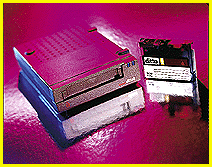

# Ditto Your Data

*Reviews*

Iomega's Ditto 2GB tape drive can back up all your data on a single cartridge -- albeit slowly.

Robert L. Hummel

Tape backup was once a murky, quirky domain where technicians tended expensive, proprietary black boxes. Today, ease of use and low prices make tape backup a sizzling consumer-oriented aftermarket. Iomega's latest entry into this pageant, the Ditto 2GB External, continues the trend toward higher-capacity media, lower-priced drives, and user-friendly software.

As the size of the average hard disk has swollen to epic proportions, so has the chance of data disaster. Given the cost of re-creating even a single complex file, personal tape-backup devices, such as the Ditto 2GB drive, are increasingly attractive.

Measuring 5.4 by 1.6 by 7.6 inches, the

Ditto 2GB

drive easily finds a home on a crowded desk. It connects to a parallel port (with printer pass-through), and it's eminently portable, weighing in at a svelte 1.4 pounds, although the largish power brick weighs 1.7 pounds.

The drive reads many quarter-inch-cartridge (QIC)-standard tape formats, but it writes only to Iomega's proprietary 1-GB format (2 GB with compression). Fortunately, formatted Ditto 2GB cartridges have a street price below $20 -- a lower cost per megabyte than comparable formats. If a tape becomes unusable for any reason, however, you'll have to replace it. Iomega decided to prevent the Ditto 2GB from formatting tapes, citing the long format time and higher cartridge price.

Single-Step Backup

The Ditto Tools backup software (developed for Iomega by Arcada Software) is as easy to use as could be. You can back up a single file or an entire set of drive volumes in one session. The simple 1-Step version, the ultimate in auto-pilot, manages backup operations automatically and restores files just as easily. More experienced users craving backup flexibility can choose from various options, including full, incremental, and differential backups. Supported environments include DOS, OS/2, and Windows 3.x and 95. Iomega promises an NT version soon.

You'll appreciate the software's support for unattended backups, given the Ditto's somewhat sluggish performance. For example, on an 8-MB 486DX/66 system running Win 95 with default settings, I measured an average disk-to-tape speed of about 4.5 MB per minute with a typical mixture of applications and data. (Iomega claims speeds up to 9.5 MBps with faster systems.) Adding in the time required to verify the backup reduced the effective backup speed to 1.7 MBpm. At that rate, filling up an entire tape could take 10 hours.

The Ditto 2GB is not without problems -- most of them common to all parallel-port tape drives. To function properly under DOS, for example, the drive needs exclusive use of a hardware interrupt. That means you have to resolve any potential conflicts with sound, network, or other expansion cards manually. Drive performance is also highly dependent on system speed. On slower systems running Windows 95, don't expect to perform other tasks while backing up in the background. It's possible, but not practical.

A Personal Ditto

The Ditto 2GB drive combines a 1-GB native capacity (or 2 GB, assuming typical file compression) with ultraportability and affordable pricing -- both for the drive and the media. And although its parallel-port interface means that it's not the fastest tape drive around, the Ditto is a solid choice for personal system backups.

## Product Information

Ditto 2GB External........................$199

* (estimated street price; for DOS, OS/2,

Windows 3.1, and Win 95)

Iomega Corp., Roy, UT

+Phone: (800) 697-8833 or (801) 778-1000

Fax: (801) 778-5763

http://www.iomega.com/

Internet:

http://www.iomega.com/

Circle 1066 on Inquiry Card.

## Ratings

Technology ****

Implementation ****

Performance ***

Key

***** Outstanding

**** Very Good

*** Good

** Fair

* Poor

## Ditto Data

Interface: Parallel port (with printer pass-through)

4Read compatibility: QIC-80, QIC-80W, QIC-3010, and

( QIC-3020; Travan TR-1, TR-2, and TR-3

%Writes: Preformatted Iomega 2GB only

Native capacity: 1 GB

Cartridge cost: Less than $20

## Ditto To Go

mailto:"rhummel@monad.net"

Robert L. Hummel is an electrical engineer, programmer, and consultant. You can reach him on the Internet at

rhummel@monad.net

## Images

