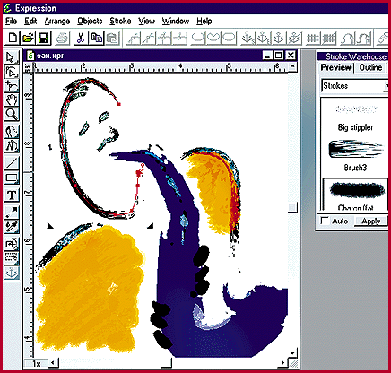

# Mr. Natural Does Vector Graphics

*What's New*

Dennis Barker

Imagine van Gogh doing technical illustrations: chip schematics done with thick dabs of yellow paint; network diagrams that look like fields of wheat. Not that you'd want impressionistic schematics, but this should give you an idea of the kind of output you can create with Expression, Fractal Design's new drawing program.

If you've worked with other vector packages, you know that to draw, you put down a path. Expression's innovation, called "skeletal strokes," lets you easily change the attributes of a path (which Fractal Design calls a "stroke"), but it also lets you apply any vector picture to a path. The best part is working with vectors in a way that's close to working with traditional art tools.

Expression's toolbox includes line- and shape-drawing tools, node tools, a freehand brush, and color gradients and fills. The Windows 95 beta version that I used delivered snappy performance without making me wait several seconds for the lines I drew to appear on-screen. I used Expression with a Wacom pressure-sensitive tablet (the ArtZ II), and the combination worked like a charm.

Expression can handle most vector formats and can save files in these formats, as well as export in bit-map formats. If I had to buy my first illustration program now, I'd buy Expression. It goes beyond the standard packages, and it has that natural feel.

## Where To Find

Expression............................$449

Fractal Design Corp.

Aptos, CA

+Phone: (800) 846-0111 or (408) 688-5300

http://www.fractal.com

Internet:

http://www.fractal.com

Circle 1030 on Inquiry Card.

## Expressive Strokes

## Images

