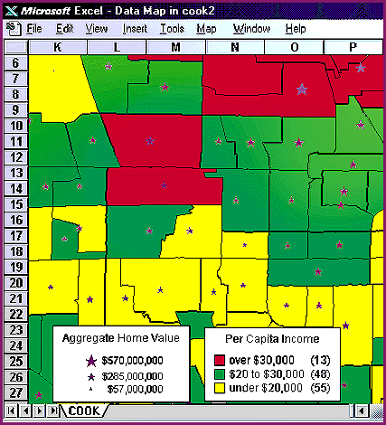

# Mapping in Excel 95

*What's New*

A mapping add-in for Microsoft Excel 95 and Microsoft Office 95, the FirstMap CD-ROM ($69) includes boundary maps and data for counties, ZIP codes, and census tracts in the U.S. The package also includes U.S. census information, such as age, gender, race, household, income, employment, and industry. In Excel, you can use FirstMap to create maps of your sales, potential earnings, and competition, from a national level to a neighborhood surrounding a specific store or outlet, and print them out.

Contact: Wessex, Inc., Winnetka, IL

+Phone: (800) 892-6906 or (708) 501-3662

http://www.wessex.com

Internet:

http://www.wessex.com

Circle 1036 on Inquiry Card.

## Maps Your Way

## Images

