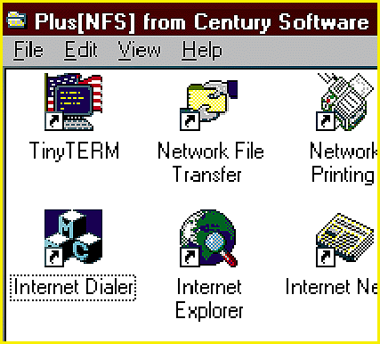

# A Client/Server Intranet Suite

*What's New*

To give desktop PC users shared access to applications, information, and peripherals located on a server or on another workstation, Plus[NFS] (single user, $199; multiple-license packages, from $179 per user) offers the TinyTerm terminal-emulation utility, which allows desktop connections to popular Unix applications; FTP file transfers; an e-mail and newsreader client; a Web browser; TCP/IP file and printer sharing; and client/server and peer-to-peer networking capabilities using TCP/IP.

Contact: Century Software, Inc., Salt Lake City, UT

+Phone: (800) 877-3088 or (801) 268-3088

http://www.censoft.com

Internet:

http://www.censoft.com

Circle 1037 on Inquiry Card.

## TinyTerm

## Images

