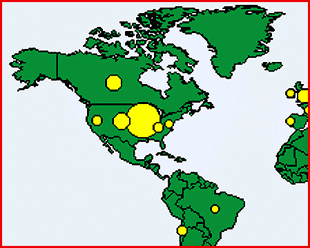

# Web-Server Log File Analysis

*What's New*

With Web Tracker 1.0 ($495), you can analyze access patterns for your Web site. The program, for Windows 3.x, 95, and NT, supports exploratory analysis through fast drill-down and a variety of trending and geographical charting functions.

Contact: Cambridge Quality Management, Inc., San Francisco, CA

Phone: (415) 750-1327

http://www.CQMInc.com/

Internet:

http://www.CQMInc.com/

Circle 1040 on Inquiry Card.

## WebTracker Pattern Analysis

## Images

