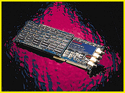

# 12-bit A/D System

*What's New*

The CompuScope 8012 ($7995) is an IBM AT-compatible ISA-bus card capable of performing 12-bit A/D conversion at real-time sampling rates up to 100 MSPS in single-channel mode and 50 MSPS in dual-channel mode, with a bandwidth of 40 MHz. The card can store up to 4 million samples in its on-board memory, and you can stack data from successive triggers.

Contact: Gage Applied Sciences, Inc., South Burlington, VT

+Phone: (800) 567-4243 or (514) 337-6893

http://www.gage-applied.com

Internet:

http://www.gage-applied.com

Circle 1052 on Inquiry Card.

## Scope It Out

## Images

