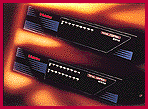

# ISDN/Analog Multiport System

*What's New*

The MP/8-I Modem and MP/16-I Modem integrate U.S. Robotics' V.34/Everything modem technology with ISDN terminal adapters. Because each port has the ability to automatically detect the remote device type, you can send or receive analog and ISDN calls. The MP/8-I ($6495) includes four ISDN terminal-adapter interfaces, supporting eight B-channels/ports. The MP/16-I ($10,995) includes eight ISDN terminal adapters, supporting 16 B-channels/ports.

Contact: U.S. Robotics, Skokie, IL

+Phone: (800) 877-2677 or (847) 982-5010

http://www.usr.com

Internet:

http://www.usr.com

Circle 1051 on Inquiry Card.

## MP Modems

## Images

