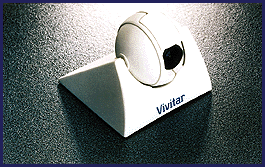

# Motion-Picture Phone

*What's New*

The Vivitar MPP-2 ($249.95), a color video phone system, transmits sight and sound over standard telephone lines using a 486-based multimedia PC and a 14.4-Kbps modem. The plug-and-play system comes with a golf-ball-size, prefocused camera that mounts on top of your monitor and provides refresh rates up to 10 fps. The package includes PictureWorks' PhotoEnhancer software and Smith Micro's VideoLink videoconferencing software.

Contact: Vivitar Corp., Newbury Park, CA

Phone: (805) 498-7008

Circle 1050 on Inquiry Card.

## Vivitar MMP-2

## Images

