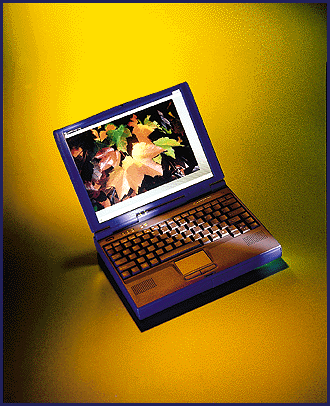

# Gateway's Big-Screen Notebook Debut

*What's New*

Robert L. Hummel

The Solo 2100 series of multimedia notebooks blends raw power and good looks into a 7-pound package that's a perfect fit for on-the-go computing. Sporting a rich set of standard features and available options, the Solo 2100 affords Gateway the hope of garnering a bigger share of the portables market.

Gateway lets you configure your Solo with a wide array of options: a 100-, 120-, or 133-MHz Pentium; a 256-KB cache; up to 40 MB of EDO RAM; and a 540-MB to 1.3-GB hard drive. Multimedia support includes a six-speed CD-ROM, which you can pop out to insert a floppy drive module as needed; 16-bit sound; and speakers. I found the sound quality from the Solo 2100 S5-120's tiny speakers adequate for Windows' sounds and business audio.

The Solo's 12.1-inch active-matrix color display (

see the photo

), which is powered by a 32-bit accelerator with 1 MB of EDO video memory, rivals a 14-inch desktop monitor. When configured for a resolution of 800 by 600 pixels and 64,000 colors, images and text were sharp and clear.

Fitting a keyboard and a pointing device onto a notebook can create problems, and the Solo 2100 S5-120 is not exempt. The keys in the top row -- including the Ins, Del, Home, End, and function keys -- are smaller than normal, making them difficult to find without peeking. And the addition of four new keys to the bottom row shrinks the space bar to a diminutive 3-inch target. The Synaptics touchpad is a joy to operate, but I soon found that its position, directly below the tiny space bar, left me no room to rest my thumbs, which led to a spate of accidental pointing and clicking.

Although it suffers from the same drawback as its peers -- cramming a lot of computer into a small package -- good looks and versatility make the Solo 2100 S5-120 an attractive choice for mobile computing.

## Product Information

Gateway 2100 S5-120.....................$3799 as reviewed

Gateway 2000

North Sioux City, SD

+Phone: (800) 846-2000 or (605) 232-2000

http://www.gw2k.com

Internet:

http://www.gw2k.com

Circle 1047 on Inquiry Card.

## Gateway Does It Powerful

## Images

