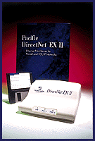

# External and Pocket Print Servers

*What's New*

The DirectNet EX II external print server and the DirectNet PEPS2 Plus pocket print server facilitate access to printer locations on NetWare, TCP/IP, and AppleTalk networks. The EX II ($399) includes two high-speed bidirectional parallel data ports; the PEPS2 Plus has one. Both units support Novell's 4.x Network Directory Service and have 10Base-2 and 10Base-T connectors.

Contact: Pacific Data Products, San Diego, CA

+Phone: (800) 737-7117 or (619) 552-0880

http://www.pacdata.com

Internet:

http://www.pacdata.com

Circle 1053 on Inquiry Card.

## DirectNet EX II

## Images

