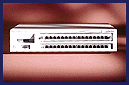

# Workgroup Switching

*What's New*

Four Fast Ethernet devices, the HiSpeed 150 series (from $7595) provides up to 32 Ethernet connections, as many as 16 Fast Ethernet connections, and the ability to let users interchange FDDI, ATM, and WAN uplinks within the same unit. All Fast Ethernet ports support automatic switchable operation at 10 or 100 Mbps.

Contact: Hitachi Computer Products, Inc., Santa Clara, CA

+Phone: (800) 448-2244 or (408) 986-9770

Circle 1055 on Inquiry Card.

## Fast Ethernet

## Images

