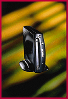

# Optical Storage on 230-MB Cartridges

*What's New*

A palmtop-size optical-storage device for Mac, Windows, and DOS computers, the SYS.230 Personal Storage System (about $359) can store images downloaded from the Internet or from digital cameras; back up and archive files and databases; store music; and transport your work between office and home. The SYS.230 transfers data at up to 2.4 MBps and offers a seek time of less than 17 ms.

Contact: Olympus Image Systems, Inc., Melville, NY

+Phone: (800) 347-4027 or (516) 844-5000

http://www.olympusamerica.com

Internet:

http://www.olympusamerica.com

Circle 1059 on Inquiry Card.

## Palm Your Data

## Images

