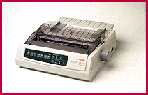

# Dot-Matrix Printers for Multipart Forms

*What's New*

Now you can print on multipart forms and on stock measuring up to twice the thickness that standard dot-matrix printers are able to handle. The Microline 320/321 Turbo (from $499) includes Courier and Gothic fonts, plus NLQ, utility, high-speed draft, and super-speed draft, as well as eight scalable bar codes. The Windows 95-compatible printer has 64 KB of RAM and a 28-KB receive buffer.

Contact: Okidata, Mount Laurel, NJ

+Phone: (800) 654-3282 or (609) 235-2600

http://www.okidata.com

Internet:

http://www.okidata.com

Circle 1060 on Inquiry Card.

## Power Printing

## Images

