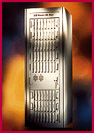

# CD-ROM Servers with Eight-Speed Drives

*What's New*

Procom's CD Tower-Rax (caddy, $56,928; tray, $56,008) rack-enclosed CD-ROM servers can contain up to 56 caddy- or tray-based CD-ROM drives to provide up to 36.4 GB of data over a network. The servers deliver a sustained data transfer rate of 1200 KBps and an average seek time of 115 ms. The CD Tower-Rax servers offer one to eight racks of seven drives; a smart board that maps each seven-drive rack to one SCSI ID; 100- or 166-MHz Pentium CPUs; 4 to 128 MB of SIMMs; eight CD-ROM management software packages; two SCSI host adapters; a VGA monitor; a keyboard; a mouse; and a hard drive.

Contact: Procom Technology, Inc., Irvine, CA

4Phone: (800) 800-8600 ext. 414 or (714) 852-1000

http://www.procom.com

Internet:

http://www.procom.com

Circle 1061 on Inquiry Card.

## CD Tower-Rax

## Images

