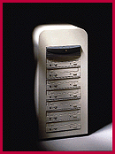

# Network CD-ROM Servers

*What's New*

The Axis StorPoint CD-ROM servers, for Ethernet and Token Ring LANs, allow users in NetWare, Windows NT/95, Windows for Workgroups, OS/2, Unix, and Web/intranet environments to access and share CD-ROMs and CD-ROM-based information over a network. The servers (from $799) have the ability to simultaneously connect seven drives directly and up to 49 drives through LUN expansion.

Contact: Axis Communications, Inc., Woburn, MA

+Phone: (800) 444-2947 or (617) 938-1188

http://www.axisinc.com

Internet:

http://www.axisinc.com

Circle 1062 on Inquiry Card.

## Axis StorPoint

## Images

