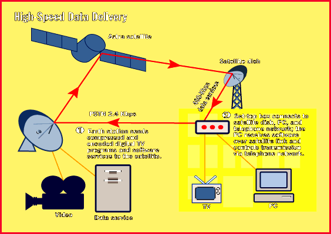

# Software via Digital Staellite TV

*International Bits*

Digital satellite TV brings broadband software services to Europe's homes.

Adele Hars

PC users in France are the first in Europe to receive commercially available

high-speed data services

from digital TV satellites. Europe's biggest pay TV provider, Canal+ in Paris, launched direct-to-home software-downloading services earlier this year. On its C: channel, a program that focuses on computer news and reports, the company offers its C:Direct service. This lets PC users download shareware, games, educational software, and benchmarking databases at 400 Kbps.

The set-top box connects to the satellite dish, the PC's parallel port, and the telephone network. You need no additional software. To trigger and control the download, the set-top box starts the transmission via telephone and receives the software in high speed over the satellite dish. The return path's bandwidth, however, is only 2.4 Kbps, but higher speeds on the return path will soon be available as an option, Canal+ says. By the end of the year, Canal+ plans to have a commercial software store in place offering graphical and musical applications as well as office tools and Internet access over satellite.

The company provides the navigation and terminal software for the download, but payment will be handled by remote control and the TV's electronic program guide. Customers can use a credit card or have the charge posted in their monthly Canal+ bill. In both cases, transactions will be processed over the telephone line.

Canal+ reckons that C:Direct subscribers will number more than 15,000 by the end of this year. The company is expected to expand the service next year to Spain, Italy, Belgium, and Germany. However, elsewhere in Europe, competition will be fierce. The German Kirch group's DF1 digital satellite TV service announced that it will offer similar services at the beginning of 1997, and pay TV group Nethold is considering interactive PC services for its digital satellite TV subscribers in the Netherlands and Scandinavia.

Today, only the downstream path of digital satellite TV services are really "on the air," and the control path runs over telephone lines, but industry experts expect bidirectional services to appear after 1998, when the Astra satellite consortium will have launched a new generation of satellites. The new systems will include transponders capable of handling bidirectional Ka-band services.

## High-Speed Data Delivery

Satellite TV services will reach homes in France, Spain, Italy, Belgium, and Germany.

## Images

