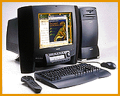

# Toshiba's First Desktop PC

*International Bits*

Targeted at home users, Infinia includes many ease-of-use features.

Rich Friedman

The world's leading notebook maker entered the hotly contested home PC market in mid-September with a vengeance. Geared to the home user, Toshiba's

Infinia line

boasts respectable PC components that are combined with consumer-electronic enhancements in an appealing design at competitive prices.

"It's a start," says Gary Elsasser, senior director of product planning for the worldwide computer systems group.

Each Infinia has a well-thought-out LCD (LED on two models) panel that provides one-touch access for checking telephone messages, making a phone call, playing an audio CD, or tuning into TV or FM radio. (A TV/FM radio capture card comes standard on the top-of-the-line Model 7200, and a remote-control device lets you access entertainment features from anywhere in the room.) Intel supplies the ATX motherboards that have two universal serial bus (USB) ports and, depending on the model, a 200-, 166, or 133-MHz Pentium processor. A digital-videodisc (DVD) drive upgrade kit costing between $600 and $700 will be available soon, as well as a camera and software for videoconferencing. The bundled software will include several leading packages, including Windows 95, Microsoft Works, Quicken SE, Microsoft Encarta 96 Encyclopedia, and, of course, the two leading Internet browsers.

Toshiba is waiting until the CeBIT show in Hannover, Germany, in March to introduce its Infinia PCs in Europe, though the European versions will be upgraded models from those now selling in the U.S. Toshiba also plans to launch a line of PCs for business users in early 1997 and a line of servers the following year.

## Infinia Home PC Product Specs

Model 7200 Model 7160 Model 7130

Processor

DCPU Pentium Pentium Pentium

Clock speed 200 MHz 166 MHz 133 MHz

NL2 cache 256-KB write-back 256-KB write-back 256-KB write-back

P pipeline burst SRAM pipeline burst SRAM pipeline burst SRAM

Memory

Standard RAM 32 MB of EDO DRAM 16 MB of EDO DRAM 16 MB of EDO DRAM

Maximum RAM 128 MB 128 MB 128 MB

3-1/2-inch Enhanced IDE HDD

Capacity 3 GB 1.9 GB 1.5 GB

O (3.1 million bytes) (2 million bytes) (1.6 million bytes)

User Interface

P InTouch module with InTouch module with InTouch module with

H LCD and remote LED display LED display

Audio

Wave-table Hardware Software Software

Gsupport wave table wave table wave table

Video

ETV/FM radio Standard Optional Optional

capture card

$ S3 Virge 3-D graphics accelerators

, 2 MB of high-speed 50-ns EDIO video memory

2 Supports up to 1280 by 1024 pixels by 256 colors

CD-ROM

Integrated 8&#215

Audio Support

Q Full-duplex 16-bit Sound Blaster Pro-compatible audio system with SRS 3-D sound

Communications

= 28.8-Kbps fax/modem (software upgradable to 33.6 Kbps DSVD)

Full-duplex speakerphone

Answering-machine application

External Interfaces

) One serial (16550 UART-compatible) port

9 One parallel (IEEE-P1284-compliant ESP-compatible) port

One external SVGA monitor port

One PS/2 mouse port

& Two universal serial bus (USB) ports

One PS/2 keyboard port

) One external microphone jack (monaural)

One speaker out jack (stereo)

One line-in jack (stereo)

One MIDI/game port

AC IN plug

Single Unit Price

B(estimated) $2799 $1999 $1699

.*All bulleted items are shared by all models.

## Infinia for the Home

Toshiba Infinia home PC.

## Images

