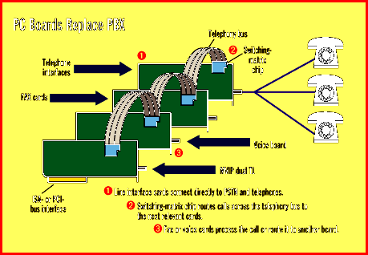
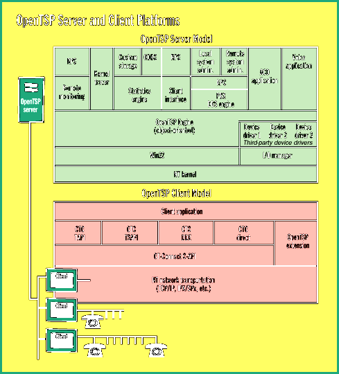

# The Surging CTI Tide

*International Features*

?Companies are replacing their PBXes with low-cost CT servers.

Bob Emmerson and David Greetham

Dancing to the mantra of more for less money, companies are rapidly replacing once-sacred PBXes with multifunction computer-telephony (CT) servers, though most replacements start at the departmental level. Large corporations are also using dedicated workgroup CT servers but continuing to use a PBX for the tasks it traditionally does well: call switching and call accounting.

In today's computer-telephony-integration (CTI) architectures, the PBX operates just as a switch. The smarts are in the CT server that sits behind the PBX. Though more innovative PBXes now support APIs, they remain foreign bodies in an open computing and communications world. A CT server's plug-in boards process all kinds of call-related duties -- interactive voice response (IVR), speaker verification, voice mail, fax on demand, and fax broadcast -- and hand the call back to the PBX with a switching instruction. What's so difficult about switching a call? Why not provide PBX-like digital switching in a server?

Many vendors are now deploying

CT boards

with switching-matrix chips (e.g., Dialogic's SC 2000 or Mitel Telecom's MT8980). These boards plug into the server's system bus at the bottom and interconnect at the top using a "mezzanine" telephony bus, a 40-pin ribbon cable. Calls come in on line-interface cards, get processed on the board, and switching instructions are added. The line-interface card then routes the call across the telephony bus to the next card.

For example, if a caller requests fax on demand, the line-interface card switches the call to a fax card; if a caller wants to talk to the sales department, the call will go to a telephony-interface card and be routed to a free agent. All this can be done without legacy switching, so you no longer need a dumb PBX.

The basic technology to do all this has been around for a while from CT VARs and systems integrators. What's new is the rapid convergence of de facto hardware and software standards and the lower prices of industrial-grade PCs.

Windows NT is becoming the preferred OS for CTI applications, and most of the board vendors provide NT drivers. NT's Exchange Server can accommodate many users with mixed-medium message traffic and seamlessly route these messages to Windows 95 Exchange clients. As Nick Wilson, managing director of Dialogic Telecom U.K., points out, "A giant leap will be the next version of Microsoft's TAPI [Telephony API], which allows users to control Windows NT-based telephony resources from TAPI-enabled clients."

Another development that is driving the move to computer-based switching is that board vendors are cramming more functionality into their products. Smaller organizations may soon be able to satisfy all their call processing and switching needs with a single board.

The Daytona voice cards from Pika Technologies (Kanata, Ontario, Canada), for example, have DSP-based (digital signal processor) voice-processing resources for up to 24 trunks per PC slot. These Multi-Vendor Integration Protocol (MVIP) boards (see the sidebar "New Switch-Ready CT Boards") come with a suite of DSP audio-processing capabilities, including full voice-card functionality, caller ID detection, and basic conferencing features. For high-end applications, you can use a daughterboard, which adds another 120 MIPS of processing power. You need this for computationally intensive tasks such as multichannel speech recognition or text to speech.

So, for less than $7000, you can turn a PC into a PBX and get a fully integrated CT solution having all the functionality any small- or medium-size enterprise could need in the near term. "We see the future of traditional PBX technology as very bleak. Open PC-based multimedia technology is causing a lot of panic in the telecom dealer channel," says Paul Smith, CTI divisional manager at Northamber, a CT component distributor in the U.K. He adds, "The market potential of CT, especially for small and medium companies, is [in contrast] huge."

Scalable Solutions

There is an obvious physical limitation to the number of cards that can go into a PC. In turn, this limits the number of ports. The current record is 256 duplex ports for an MVIP system and 512 duplex ports for a Signal Computing System Architecture (SCSA) system. To extend this figure, you can use ISA extension boxes and build larger systems by interconnecting two or more PCs using multichassis MVIP buses. This feature gives PBXes in PCs their impressive scalability. However, there is also a limit to the number of PCs that you can interconnect: PC-based switching currently works at 1536 ports, whereas large PBXes can go to 10,000 ports and more.

"Although new standards are emerging that will increase this figure, the really big boost will come from ATM [asynchronous transfer mode]," says Ruud Peeters, marketing director of VSN Systemen, a CT software house. "Companies who can live within the limitation of 1500 ports and currently have a PBX might as well introduce CT on a departmental basis and then scale the solution up over time, with the long-term objective being replacement of the legacy switching hardware when it has been fully amortized."

The move to PC-based switching is being hastened by easy-to-use CT applications generators that let programmers and even end users develop customized programs without having to be concerned with the nitty-gritty details of the connecting hardware. Sophisticated applications generators are quickly coming to market. Some recent European products are Envox CT Studio, from Envox, and NextInfo, from VoiceBit. They run in a Windows environment and have RAD-like (rapid application development) features.

A Universal API for CTI

What will ultimately pave the way to PC-based switching is a single standard for the boards and an API superset, a framework that can embrace other CT APIs -- MAPI, TAPI, and Telephony Server API (TSAPI) -- and also handle PBX-type switching and call control. The Enterprise Computer Telephony Forum (ECTF), an industry consortium of key CT players, is working on two standards: H.100 and S.300.

H.100 is a hardware standard that could finally merge MVIP and SCSA. It would let CT boards move up from today's ISA architecture to PCI. Dialogic (Brussels, Belgium), Mitel, and Natural MicroSystems (Natick, MA) support it, so it may become a de facto standard. Expect to see the first H.100-compliant boards early next year. S.300, the ECTF's Service Provider Interface (SPI) specification, defines the management of call-channel resources and interfaces for extending all kinds of system services. Industry players agree that it will take another year before S.300 is fully rendered.

CT Middleware

In the interim, systems integrators and software developers will continue to work with middleware and vendor-specific Software Development Kits (SDKs) to implement call-center applications or Automatic Call Distribution (ACD). Mitel is a driving force behind client/server telephony. Its MediaPath platform lets programmers develop CTI applications in C, C++, or Tcl/Tk (a public domain scripting language). VSN Systemen offers its OpenTSP Telephony Server Platform (see the figure

%"OpenTSP Server and Client Platforms"

q), which is object-oriented and enables you to process, reroute, or compress voice, fax, e-mail, and even video.

OpenTSP makes all the functionality of a top-flight PBX available to the client application. It also provides PBX statistics to the corporate database through an Open Database Connectivity (ODBC) link. This tightly integrated functionality lets developers implement powerful ACD systems on small systems at a relatively low cost.

This solution is particularly attractive for companies who have a legacy PBX but wish to add CT functionality (e.g., a call center). Instead of taking the TSAPI route, which entails paying for a CT link between the server and the switch, they can fit an OpenTSP server between the PBX and the public telephone network. Over time, the company can extend the benefits of CT applications to an increasing number of users simply by adding more cards to the NT server and then by daisy chaining two or more of the servers together.

PBX-in-a-PC solutions switch voice calls to phones and also connect to the LAN for data communications (i.e., they use both cabling infrastructures). Eliminating the PBX brings the hardware cost way down and stops you being from being "locked in" to a closed, proprietary environment. However, it does not provide true integration of voice and data, because applications cannot treat voice as just another digital-medium type.

Many experts believe ATM is the solution because it integrates voice and data in one infrastructure. However, the price is high because the organization must install a new network environment. PhoNet Communications developed an interesting alternative. Its EtherPhone system uses existing Ethernet LAN structures and regular telephones. Combined telephone/network interface cards convert voice to Ethernet data packets and transmit calls over the data network in real time. According to CEO Yoraon Baratz, EtherPhone eliminates the latency problem by monitoring the network load and changing the distribution behavior. The LAN server houses software modules for voice mail, ACD, and billing information. These modules also control the external interfaces and the telephony system.

You can achieve true CTI only when voice traffic runs seamlessly over a LAN infrastructure. EtherPhone is a great concept for companies with an Ethernet LAN in place and looking for an upgrade from a small key system to a PBX, but it can't provide ATM's flexibility in transporting isochronous, multimedia traffic. Mitel and Madge Networks, for example, demonstrated a solution called Networked Voice and Data (NeVaDa) at Networks 96 in Birmingham, U.K. NeVaDa integrates real-time voice, video, and data onto a common, enterprise 155-Mbps ATM LAN backbone. It uses a single protocol to carry voice and data, thereby letting telephone and LAN traffic share one infrastructure and thus avoid the expense and overhead of two separate networks.

All these developments show that the closed, proprietary world of the PBX is over. The PBX will continue to have a role, particularly in large organizations, but the benefits of PC-based switching and advanced telephony are irresistible.

De facto open standards like SCSA and MVIP have created this market, enabling CT players to cooperate and compete. The work the ECTF is doing will carry this process further. Scalable solutions are already on the market, but in the future, changing the feature set will be easier and the choice much wider. Dino Joannides, Mitel's director of business development in Europe, says, "Don't be surprised when shrink-wrapped applications that offer CT features of big PBXes start appearing on the shelves of your software dealer sometime next year."

## Where To Find

Envox

Zagreb, Croatia

Phone: +385 1 249070

Fax: +385 1 249306

E-Mail: envox@alf.tel.hr

http://ccb.tel.hr/envox

Internet:

http://ccb.tel.hr/envox

Madge Networks Europe

High Wycombe, U.K.

Phone: +44 1628 858000

Fax: +44 1628 858011

E-mail: dpool@madge.com

http://www.madge.com

Internet:

http://www.madge.com

Mitel Telecom

Slough, U.K.

Phone: +44 1753 816300

Fax: +44 1753 816333

#E-mail: dino_joannides@mitel.com

http://www.mitel.com

Internet:

http://www.mitel.com

PhoNet Communications

Herzliyya, Israel

Phone: +972 9 502134

Fax: +972 9 567432

E-mail: phonet@shani.net

VoiceBit

Oulu, Finland

Phone: +358 81 537 2353

Fax: +358 81 537 2338

$E-mail: juho.toivonen@voicebit.fi

VSN Systemen

Venray, The Netherlands

Phone: +31 478 555000

Fax: +31 478 589563

## PC Boards Replace PBX

Because CT boards deploy switching-matrix chips, they have the power to eliminate a corporate PBX.

$OpenTSP Server and Client Platforms

OpenTSP Telephony Server Platform enables you to process, reroute, and compress voice, fax, e-mail, and even video.

mailto:"73252.1364@compuserve.com"

mailto:"editors@bix.com"

Bob Emmerson is a BYTE correspondent who is based in Eindhoven, the Netherlands. David Greetham is a consultant with Greetham Associates (Turnhout, Belgium). You can reach them on the Internet at

73252.1364@compuserve.com

editors@bix.com

## Images

