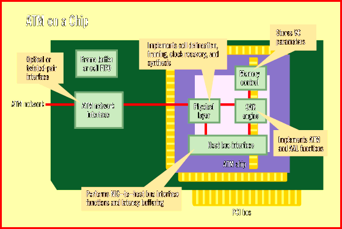

# Single-Chip ATM Adapters

*International Features*

Rainer Mauth

Key to the flexibility of asynchronous transfer mode (ATM) is the ATM Adaptation Layer (AAL). It provides transport for many types of services within one format. The AAL inserts payload data into the 48-byte information field of an ATM cell and carries such network services as constant bit rate (CBR), variable bit rate (VBR), and available bit rate (ABR), which is most important for LAN emulation over ATM.

The AAL's duties aren't handled by the network, however; they must be overseen by the network interface card (NIC). The NIC's main tasks include real-time communications, interactive connection establishment, and LAN emulation (LANE).

There are two types of NICs for ATM: products that incorporate the logic in silicon on an ATM ASIC, and products that deploy a general-purpose processor and do the processing in software. Both approaches share a single goal: the

one-chip ATM adapter

For example, ATML's (Cambridge, U.K.) new Streamlink adapter board deploys an ATM chip, codeveloped by ATML and Cirrus Logic (Fremont, CA), that combines an ARM7 processor core, a PCI interface, and static RAM (SRAM) on a single die. The card's so-called AToM chip conducts the segmentation and reassembly (SAR) of all data that passes through the network, handles User-to-Network Interface (UNI) signaling, and performs LAN emulation.

The big advantage of having a NIC based on an embedded RISC processor is the resulting flexibility. To adapt systems to new environments, the software running on the processor can easily be updated. This is particularly important in the ATM world, where standards are not yet completely finalized. The Streamlink adapter is expected to be released in 25- and 155-Mbps versions in December, with prices starting below $200 for the 25-Mbps version and below $500 for the 155-Mbps version.

NICs that incorporate a single-chip ATM ASIC will hit the market early next year. In addition to having an ATM chip, they will deploy either a frame buffer or a plain first-in/first-out (FIFO) buffer. Because they will work without any external memory, these NICs will be priced aggressively, industry sources say. However, FIFO-based chips rely heavily on fast bus-mastering PCI interfaces that use DMA to stream ATM cells into the host memory. Adapter cards with single-chip ATM ASICs will come from companies such as Olicom (Lyngby, Denmark).

ATM ASICs are being developed by such companies as Fujitsu Microelectronics (Manchester, U.K.) and Siemens (Munich, Germany). In addition, PCM-Sierra (Vancouver, British Columbia, Canada) released one of the first ATM ICs, the Lasar-155, earlier this year. This IC, which is designed for 155-Mbps ATM NICs, includes a FIFO buffer for eight cells in the transmit direction and 96 cells in the receive direction. ATM ASICs are said to perform more efficiently in AAL 5 functions (i.e., reassembly and error control) and in the scheduling of cells based on network burstiness (known as traffic shaping) because they don't have to cope with any software overhead.

## ATM on a Chip

_All-in-one ATM chips enhance performance and reduce the price of ATM network interface cards.

mailto:"rmauth@bix.com"

Rainer Mauth is a senior editor and bureau chief in BYTE's Frankfurt office. You can contact him at

rmauth@bix.com

## Images

