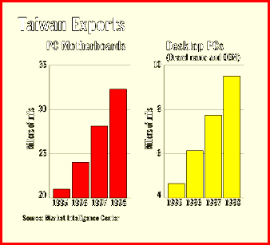
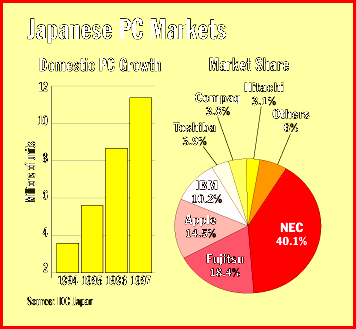
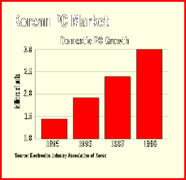
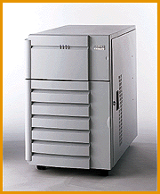

# The Rise of Asian PCs

*International Features*

6Expect more powerful PCs and servers for less money.

Mark LaPedus

Asian PC companies experienced mixed success in the early 1990s. However, they are now making a resurgence in the worldwide desktop and server markets, as they begin to leverage their strengths in consumer electronics. Taiwan's Acer, which had major losses in the early 1990s, is projected to jump from being the world's eighth-largest PC supplier in 1995 to the second-largest player by the year 2000, says Jason Lin, an industry analyst at

Dataquest Taiwan

.. This will put Acer next to Hewlett-Packard.

Japan is

also knocking on the door. Last spring, NEC merged its international PC operations with Packard Bell, forming the world's largest PC company. What's more, NEC, Fujitsu, Hitachi, Toshiba, and Sony will expand or reenter the worldwide PC and server markets later this year. The timing couldn't be worse for these companies. Amid falling margins and a price war in the industry, all PC makers are finding it increasingly difficult to differentiate their products.

Unlike consumer electronics, Asian companies do not drive the PC business. Thus, to get a feel for where the PC is heading, it's important to look at what Intel and Microsoft, the dominant forces in the industry, are planning. By the end of the year, Microsoft will unveil its PC 97 Design Guide, a set of guidelines for designers of future PCs and peripherals -- which, of course, must be compliant with Windows 95 and NT.

For Intel, "the driving force for the Pentium Pro will be the acceptance of Microsoft's Windows NT 4.0," a 32-bit OS with the Windows 95 interface that takes full advantage of the superpipelined architecture of the microprocessor unit (MPU), says Takahiko Umeyama, senior PC analyst at IDC Japan. In fact,

Acer,

X Compaq, NP, IBM, and others are rushing to release their Pentium Pro-based NT servers.

As a result, Pentium Pro-based system prices are dropping. In the middle of this year, for example, NEC's PC-9821Ra20, which sold for $3980 in Japan, came with a 200-MHz Pentium Pro processor, 16 MB of RAM, a 1.2-GB hard drive, 64-bit PCI graphics, and a 100-Mbps LAN controller. And Dell's Optiplex GXPro 200 Pentium Pro-based machines cost $2899 for the entry-level 180-MHz system, about $5000 for a midrange 200-MHz desktop, and $7990 for a dual-CPU system.

By the end of this year, however, you will get much more for your money, according to people familiar with Intel's systems road map for OEM customers. For example, an entry-level Pentium Pro-based desktop with roughly the same features as NEC's PC-9821Ra20 could go for only $1800 or less -- nearly the same price as a 133-MHz Pentium-based PC in the middle of this year. A midrange desktop based on a 200-MHz Pentium Pro may cost $2000 to $3000.

A full-blown box will include 32 MB of RAM, a 1.2-GB hard drive, 64- or 128-bit (or 3-D) graphics, an eight-speed (or faster) CD-ROM drive, a 10-/100-Mbps LAN card, full-duplex audio, videoconferencing capabilities with a charge-coupled-device (CCD) camera, a 15-inch monitor, and the universal serial bus (USB), which connects up to 127 peripherals over a 12-Mbps network. (Intel is still wavering about support for a competitive technology endorsed by Apple and Sony, called IEEE-1394 or Firewire, a bus that offers 100- to 400-Mbps transfer rates.)

A high-end 200-MHz Pentium Pro desktop could go for $3200 or less. It has features similar to midrange desktops, but the high-end box supports NT 4.0 and other OSes, as well as 3-D graphics controllers that provide z-buffering, color interpolation, texture mapping, rendering, and arcade-game-like functions. There is support for 3-D APIs such as OpenGL, Direct3D, and others. (In 1997, Intel will implement its Accelerated Graphics Port [AGP], a memory bus that provides a 200-Mbps link between the graphics accelerator and the chip set, bypassing the overtaxed 133-Mbps PCI bus.)

Intel's road map implies that a key for all desktops is connection to the Internet. "The 14.4-Kpbs modems are being phased out," says T. G. Wang, vice president of Taiwan's GVC, the world's second-largest modem maker as well as a major supplier of PC boards, notebooks, and monitors. "Faster modems or ISDN will become necessary for many applications." GVC will enter several new modem markets by the end of the year: Digital Simultaneous Voice and Data (DSVD), Asymmetric Digital Subscriber Line (ASDL), cable modems, and others. The most promising one is DSVD, which simultaneously transmits data and voice signals over a single dial-up phone line using V.34 modulation.

1997 and Beyond

Early next year, PC makers will begin to offer systems based on the next-generation Pentium chip, the long-awaited P55C, a 200-MHz device with multimedia extensions, dubbed MMX. MMX will boost performance on many audio and video applications. Intel will also have a new-and- improved Pentium-level chip set. Called the 430TX, it supports extended-data-out (EDO) and synchronous DRAM (SDRAM), USB, AGP, and other functions.

In early to mid-1997, look for desktops and servers based on Intel's next-generation Pentium Pro, code-named Klamath. It's a 200-/234-MHz MPU with a larger L1 cache than the current MPU but no internal L2 cache. Next year, Intel will also talk about the code-named Deschutes, a low-power version of Klamath, reportedly for use in notebooks. Both Klamath and Deschutes will include MMX. By then, Intel will also have a new chip set for its Pentium Pro, called 440LX, which supports multiprocessing, SDRAM, USB, AGP, and other features.

In the next year or two, PC makers may offer fast accelerators based on Microsoft's Talisman project, an effort that hopes to put high-end workstation graphics on inexpensive PCs. In theory, Talisman displays 3-D objects by using a highly intelligent chip called a compositor, which picks up and textures polygons on the fly.

"Next year, we will offer a home PC based on a Pentium Pro," says Arthur Pai, director of product management at Acer, which is also reportedly looking at the P55C for the home market. "We will also offer [Klamath] for our entry-level and midrange servers."

You shouldn't expect the P7 -- a 64-bit 787-based processor currently being codeveloped by Intel and HP -- until 1998. The P7, code-named Merced, is for high-end Unix servers. Contrary to popular belief, though, Merced won't use a very-long-instruction-word (VLIW) design; instead, it will use a modified superscalar architecture with instruction-level parallelism, sources say.

New Japanese Push

Japan's PC industry is gearing up for a renewed push into the U.S. With the exception of Toshiba, which is the world's largest notebook maker, most Japanese computer suppliers have mainly focused on the domestic market.

As mentioned earlier, NEC, Japan's largest PC maker with more than 40 percent of the market share, has merged its international PC operations with Packard Bell. Meanwhile, Toshiba will sell in the U.S. a new line of PCs that are geared for the home market. Earlier this year, Fujitsu entered the notebook field. This fall, it will launch a line of desktops and servers for the international markets with its U.K.-based subsidiary, ICL.

Still, the question lingers: Will the Asian PC vendors dominate going into the next century? They have an advantage in their closer geographical and sometimes ethnic ties to some of the faster-growing markets in the region, including China, India, and Indonesia.

It will take vast resources to survive the cutthroat PC business, a market that favors the big conglomerates in Japan

and Korea

. Not all will survive. Hong Kong's PC vendors have nearly disappeared, while companies in Singapore are focusing on niche markets. China's PC vendors are not a factor outside their country.

The shakeout in the PC business has already taken place in Taiwan. Acer is the only vendor remaining with worldwide brand name recognition. Most of the remaining PC players in Taiwan build products for OEMs.

The survivors in the PC business have some common traits, including strong technology, distribution, and brand name recognition. Says IDC Japan's Umeyama: "To be successful, a company needs to be strong in all three areas."

## Where To Find

Acer, Inc.

Taipei, Taiwan R.O.C.

Phone: +886 2 545 5288

Fax: +886 2 545 5308

http://www.acer.com/

Internet:

http://www.acer.com/

Asustek

Computer, Inc.

Taipei, Taiwan R.O.C.

Phone: +886 2 894 3447

Fax: +886 2 896 7761

First International Computer, Inc.

Taipei, Taiwan R.O.C.

Phone: +886 2 717 4500

Fax: +886 2 714 8676

http://www.fic.com.tw/

Internet:

http://www.fic.com.tw/

Fujitsu Ltd.

Tokyo, Japan

Phone: +81 44 754 8577

Fax: +81 44 754 8554

http://www.fujitsu.com.jp/index-e.html

Internet:

&http://www.fujitsu.com.jp/index-e.html

GVC Corp.

Taipei, Taiwan R.O.C.

Phone: +886 2 755 2226

Fax: +886 2 755 2513

E-mail: twang@gvc.com.tw

## Taiwan Exports

6Exports of Taiwan's desktop PCs and PC motherboards.

## Japanese PC Markets

Growth of Japan's domestic PC market and market share of PC companies.

## Korean PC Market

@Growth of Korea's domestic PC market in terms of unit volumes.

## AcerAltos 19000 Server

mailto:"5916955@mcimail.com"

Mark LaPedus is a BYTE contributing editor based in Taipei. You can reach him by sending e-mail to

5916955@mcimail.com

## Images

