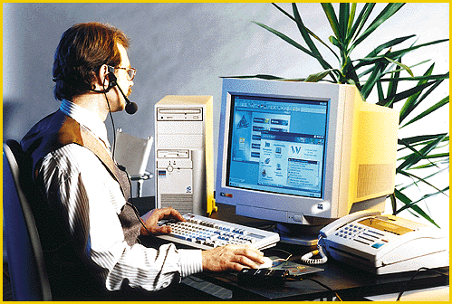
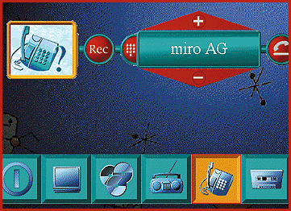

# Communications Command Center

*International What's New*

Rainer Mauth

The big strength of the miroMedia Online communications package is its versatility. The product is a hybrid V.34 modem and sound card that's based on IBM's Mwave DSP technology. In combination with intelligent media management software, the board works as the command center for all your PC communications needs.

The package provides a complete phone subsystem, including a speakerphone, voice mail, and an answering machine. The included fax software offers integration with Microsoft Exchange and fax-forwarding functionality. Also, its Digital Simultaneous Voice and Data (DSVD) features let you speak to a remote collaborator and share applications at the same time over the same phone line.

The wave-table sound subsystem allows for good-quality audio recording, playback of audio CDs, and sound editing. The system can be upgraded via an FM radio-receiver piggyback board that enables digital audio recording directly to a hard disk.

## Where To Find

miroMedia Online....................DM 399 (plus DM 119 for the radio upgrade)

miro Computer Products AG

Braunschweig, Germany

Phone: +49 531 21130

Fax: +49 531 211399

http://www.miro.de

Internet:

http://www.miro.de

Circle 988 on Inquiry Card.

## Versatile Communications

## Smart Media Management

## Images

