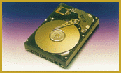

# High-Speed Hard Disks for Mobile Computers

*International What's New*

The robust Travelstar 2LP 5-1/4-inch hard drives are optimal devices for mobile computers: They measure 12.5 mm high and weigh only 140 grams. These devices use IBM's Adaptive Battery Life Extender technology and can store up to 2.1 MB. With a 128-KB cache and DMA-mode-2 functionality, they achieve data transfer rates up to 16.6 Mbps.

Price: Starts at DM 320 for 540 MB.

;Company: MCE Computer Peripherie GmbH, Ottobrunn, Germany

Phone: +49 89 609 10 86

Fax: +49 89 609 20 17

Circle 989 on Inquiry Card.

## Travelstar Takes You Computing Places

## Images

