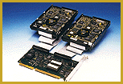

# RAID-1 Controller for IDE Drives

*International What's New*

AC-Mirror, a fault-tolerant RAID-1 IDE controller, makes an efficient data-security solution for single PCs. The product has the ability to work with as many as four hard drives of different capacities. The AC-Mirror system, which requires no driver software, supports DOS, Windows, NetWare, OS/2, and most Unix flavors.

Price: DM 300.

6Company: Hantz & Partner GmbH, Gundelfingen, Germany

Phone: +49 761 592100

Fax: +49 761 585228

%E-mail: 100431.2606@compuserve.com

Circle 991 on Inquiry Card.

%Efficient Security Up To Four Drives

## Images

