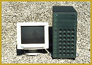

# Do MPEG-2 on Your Desktop

*International What's New*

The MPEG PFW 6000 is a 166-MHz Pentium machine that has the ability to convert video into MPEG-2 half D-1 or full D-1 format. The system includes 32 MB of RAM, a 4-GB hard drive, four RISC chips on two separate PCI boards, a dedicated MPEG-2 playback board, a PC-based scope, and a digital noise filter. With this workstation, you can produce MPEG-1 for video CD and MPEG-2 video streams with 704- by 576-pixel resolution and 15-Mbps data streams.

Price: Starts at DM 99,900.

7Company: APE Ptacek Engineering GmbH, Munich, Germany

Phone: +49 89 630209 0

Fax: +49 89 630209 90

Circle 996 on Inquiry Card.

## Video-to-MPEG Conversion

## Images

