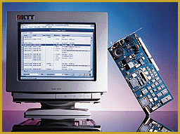

# New Fax-Testing Boards for Product Developers

*International What's New*

Aspect 4G, a dedicated fax-protocol testing board, includes Windows software that runs preprogrammed tests, manages private protocols, and passively observes protocols. The system can analyze V.34 modulation, V.8 frames, and compatibility with T30 and T4. The product is designed for regulatory organizations, test laboratories, and product developers.

Price: Call company.

*Company: KTT, Fontenay-sous-Bois, France

Phone: +33 1 43 94 0505

Fax: +33 1 43 94 9161

E-mail: info@ktt.fr

http://www.ktt.fr

Internet:

http://www.ktt.fr

Circle 993 on Inquiry Card.

## Dedicated to Fax Testing

## Images

