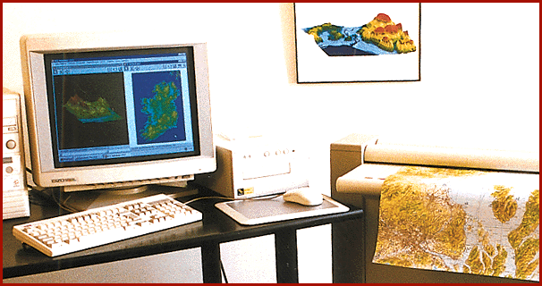

# Raster-Image System for Cartographers

*International What's New*

Digimap 3D is a complete package for producing raster images and digital terrain models from paper maps, satellite images, aerial photographs, and digital files. This Windows system has a 32-bit graphics kernel and simultaneously manages multiple layers of cartographic information in any type of projection. Other features include data extraction, geocoding, terrain-data interpolation, and geographic transformation. System hardware includes a large-format color scanner, a CD-ROM recorder, and two 166-MHz Pentium PCs.

Price: Call company.

Company: ATDI, Paris, France

Phone: +33 1 40 07 0440

Fax: +33 1 40 17 0477

Circle 995 on Inquiry Card.

## Raster Maps and Digital Terrain

## Images

