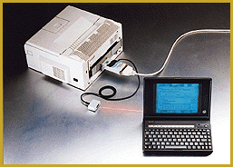

# Speedy Infrared Printer Interface for Data Transfer

*International What's New*

InterCon-InfraPrint, an infraredprinter interface for all parallel printers, provides notebook computer users with an IRDA-compatible infrared sensor to transfer data without cable connections. It sends data at rates up to 115 Kbps across distances up to 1 meter. The device automatically switches between the infrared sensor and the normal parallel ports, so no data can get lost.

Price: DM 395.

7Company: SEH Computertechnik GmbH, Bielefeld, Germany

Phone: +49 521 94 22 60

Fax: +49 521 44 40 49

E-mail: rcl@seh.de

http://www.seh.de

Internet:

http://www.seh.de

Circle 1000 on Inquiry Card.

$Infrared a Bright Transfer Solution

## Images

