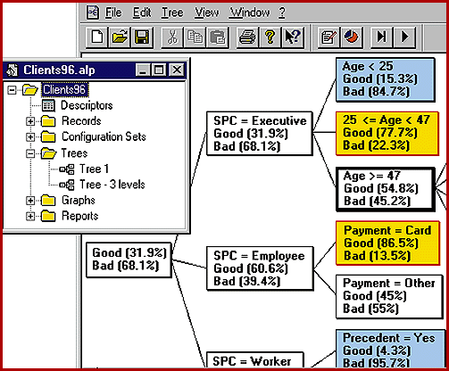

# Data Mining for Business Users

*International What's New*

Rainer Mauth

Finally there's a program that can bring data mining to your marketing department's desktops. Alice, a streamlined version of ISoft's decision-tree-based AC2 data-mining product, is designed for mainstream business users. It's a major step on the road toward easy-to-use and easy-to-understand data mining.

With Alice, you select a data source -- a spreadsheet, a database, or the output of a statistical package -- and point at the field you want to analyze. This Windows 95 application then uncovers the patterns behind the data. Like AC2, it represents results in decision trees, giving you a good grasp of the basic correlation and allowing for an easy check of hypotheses.

Of course, there are trade-offs. Don't expect fine-tuning or validation facilities. And you can't specify the properties and parameters of an analysis or cross-validate the results. But most marketing users don't require such features.

Alice provides an intuitive and quick way to discover the secrets that underlie complex databases. For users who need more specific features for certain application fields (e.g., risk evaluation), ISoft plans to offer vertical add-ons to Alice.

## Where To Find

Alice.........................$985

Soft

Gif sur Yvette, France

Phone: +33 1 69 41 2777

Fax: +33 1 69 41 2532

E-mail: alice@isoft.fr

## Trimmed Down Data Mining

## Images

