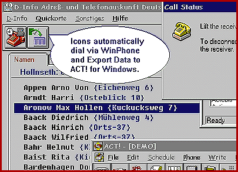

# WinPhone+ Adds Calling to Windows Applications

*International What's New*

The latest version of WinPhone+ works with standard World Wide Web browsers and automatically dials any number appearing on a Web page. In addition, the telephony program can dial out of any standard DOS, Windows 3.x, or Windows 95 program and is compatible with Windows NT 4.0. WinPhone+ reveals details of inbound calls and suggests best dial-out times based on tariff information. It also communicates with standard palmtop computers and supports GSM Short Message Service (SMS).

Price: DM 199.

'Company: MegaSoft GmbH, Wien, Austria

Phone: +43 1 470 2022

Fax: +43 1 470 2022 77

!E-mail: herbert@megasoft.co.at

http://www.megasoft.co.at

Internet:

http://www.megasoft.co.at

Circle 979 on Inquiry Card.

## Dialing Web Contacts

## Images

