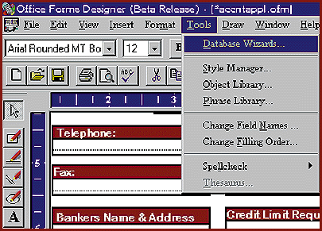

# Electronic and Printed Forms Processing

*International What's New*

Office Forms' database link Wizard provides a new way for organizations to handle their electronic and printed forms and is compatible with Microsoft Office 95. Forms can be compiled into an EXE file so that persons outside the company can supply data (a run-time version in the EXE file is all that's needed). Distributed forms can include validation checks, calculations, and user-defined help on how to fill out the form.

Price: 40 Pounds UK per seat.

;Company: Top-level Computing, Ltd., Gloucestershire, U.K.

Phone: +44 1453 753955

Fax: +44 1453 753933

Circle 980 on Inquiry Card.

## Almost-Magical Forms Processing

## Images

